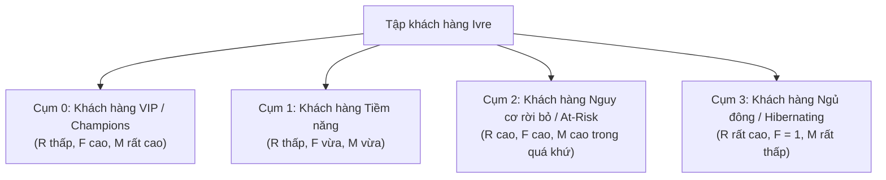

# BÁO CÁO BÀI TẬP LỚN: PHÂN TÍCH DỮ LIỆU THƯƠNG MẠI ĐIỆN TỬ THỜI TRANG
## ĐỀ TÀI: KHAI PHÁ DỮ LIỆU GIAO DỊCH VÀ PHÂN KHÚC KHÁCH HÀNG NHẰM TỐI ƯU HÓA HOẠT ĐỘNG KINH DOANH CHO CỬA HÀNG THỜI TRANG IVRE

---

## MỤC LỤC
1. [TỔNG QUAN ĐỀ TÀI & BÀI TOÁN KINH DOANH](#1-tổng-quan-đề-tài--bài-toán-kinh-doanh)
2. [THU THẬP & KHÁM PHÁ DỮ LIỆU (DATA UNDERSTANDING & EDA)](#2-thu-thập--khám-phá-dữ-liệu-data-understanding--eda)
3. [TIỀN XỬ LÝ VÀ LÀM SẠCH DỮ LIỆU (DATA PREPROCESSING & CLEANING)](#3-tiền-xử-lý-và-làm-sạch-dữ-liệu-data-preprocessing--cleaning)
4. [KỸ THUẬT TẠO ĐẶC TRƯNG (FEATURE ENGINEERING)](#4-kỹ-thuật-tạo-đặc-trưng-feature-engineering)
5. [KHAI PHÁ DỮ LIỆU & MÔ HÌNH HÓA (DATA MINING & MODELING)](#5-khai-phá-dữ-liệu--mô-hình-hóa-data-mining--modeling)
   - 5.1. Phân cụm khách hàng RFM bằng thuật toán K-Means
   - 5.2. Khai phá luật kết hợp giỏ hàng bằng thuật toán Apriori
   - 5.3. Phân tích chuỗi thời gian và xu hướng bán hàng
6. [KẾT QUẢ ĐÁNH GIÁ & ĐỀ XUẤT CHIẾN LƯỢC KINH DOANH](#6-kết-quả-đánh-giá--đề-xuất-chiến-lược-kinh-doanh)
7. [HƯỚNG DẪN THỰC THI THỰC NGHIỆM TỪNG BƯỚC (REPRODUCIBILITY GUIDE)](#7-hướng-dẫn-thực-thi-thực-nghiệm-từng-bước-reproducibility-guide)

---

## 1. TỔNG QUAN ĐỀ TÀI & BÀI TOÁN KINH DOANH

### 1.1. Bối cảnh
Trong ngành bán lẻ thời trang may mặc trực tuyến (Fashion E-Commerce), vòng đời sản phẩm ngắn, tính mùa vụ cao và hành vi mua sắm của khách hàng thay đổi liên tục. Cửa hàng thời trang **Ivre (FashionStore)** đang phát triển nền tảng mua sắm trực tuyến nhưng đứng trước những bài toán kinh doanh then chốt cần trả lời:
* Khách hàng thuộc những nhóm nào? Nhóm nào đem lại doanh thu cao nhất và nhóm nào có nguy cơ rời bỏ?
* Các trang phục/phụ kiện nào thường xuyên được khách mua cùng nhau để thiết lập các combo khuyến mãi và đề xuất trong tính năng phòng phối đồ (*Virtual Styling Studio*)?
* Khung giờ và thời điểm nào trong tuần/tháng có sức mua lớn nhất để tối ưu hóa ngân sách tiếp thị và lịch đăng bài lookbook?

### 1.2. Mục tiêu nghiên cứu của bài tập lớn
Áp dụng quy trình chuẩn **CRISP-DM (Cross-Industry Standard Process for Data Mining)** trên tập dữ liệu giao dịch e-commerce quy mô lớn để:
1. Xây dựng pipeline tiền xử lý, làm sạch và làm mịn dữ liệu giao dịch chuẩn khoa học.
2. Trích xuất chỉ số $RFM$ (Recency - Frequency - Monetary) và phân cụm khách hàng bằng thuật toán học không giám sát **K-Means Clustering**.
3. Khai phá luật kết hợp giỏ hàng (**Market Basket Analysis**) bằng thuật toán **Apriori** để tìm kiếm các quy tắc bán chéo (*Cross-selling*).
4. Phân tích chuỗi thời gian (*Time-Series Trend Analysis*) để phát hiện thời điểm vàng mua sắm.

---

## 2. THU THẬP & KHÁM PHÁ DỮ LIỆU (DATA UNDERSTANDING & EDA)

### 2.1. Nguồn dữ liệu thực nghiệm (Dataset Benchmark)
Sử dụng bộ dữ liệu **Online Retail Dataset** từ *UCI Machine Learning Repository* (kho dữ liệu chuẩn benchmark quốc tế cho nghiên cứu E-Commerce):
* **Quy mô**: 541.909 dòng giao dịch thực tế, bao gồm 8 thuộc tính.
* **Thời gian ghi nhận**: 01/12/2010 đến 09/12/2011.

| Tên cột | Kiểu dữ liệu | Ý nghĩa | Vấn đề ban đầu phát hiện |
| :--- | :--- | :--- | :--- |
| `InvoiceNo` | Nominal / String | Mã hóa đơn 6 chữ số | Có các mã bắt đầu bằng chữ `C` (Cancellation - đơn hủy) |
| `StockCode` | Nominal / String | Mã SKU sản phẩm | Chứa một số mã dịch vụ phi sản phẩm (`POST`, `D`, `M`, `BANK CHARGES`) |
| `Description` | Nominal / String | Tên mô tả trang phục/hàng hóa | 1.454 dòng bị khuyết (`NaN`), một số dòng chứa ghi chú lỗi kho |
| `Quantity` | Numeric / Integer | Số lượng sản phẩm trên đơn | Tồn tại giá trị âm (lên đến -80.995) và ngoại lệ cực lớn |
| `InvoiceDate` | Temporal / Datetime | Ngày giờ phát sinh đơn | Cần phân tách thành giờ, thứ trong tuần, tháng |
| `UnitPrice` | Numeric / Float | Đơn giá sản phẩm (Bảng Anh / VND quy đổi) | Tồn tại giá trị bằng 0 và giá trị âm (lỗi điều chỉnh kế toán) |
| `CustomerID` | Nominal / Float | Mã định danh duy nhất của khách | 135.080 dòng bị thiếu (`NaN`) do khách không đăng nhập lúc mua |
| `Country` | Nominal / String | Quốc gia của khách hàng | Đa số là Vương quốc Anh (>90%), phần còn lại rải rác châu Âu |

### 2.2. Khám phá phân phối dữ liệu (EDA)
* **Phân phối của `Quantity`**: Giá trị trung vị ($\text{Median} = 3$), nhưng độ lệch chuẩn rất lớn do xuất hiện các đơn bán buôn cực lớn hoặc đơn hoàn hàng đột biến.
* **Phân phối của `UnitPrice`**: 95% đơn hàng có đơn giá nằm trong khoảng từ 0.5 đến 15 đơn vị tiền tệ. Các dòng giá trị bằng 0 là các dòng quà tặng hoặc hàng mẫu lỗi.

---

## 3. TIỀN XỬ LÝ VÀ LÀM SẠCH DỮ LIỆU (DATA PREPROCESSING & CLEANING)

### 3.1. Các bước thực hiện & Lý giải chuyên sâu (*The "Why"*)

#### Bước 1: Xử lý đơn hàng hủy và giá trị số lượng âm (`Quantity < 0`)
* **Thao tác**: Lọc các dòng có `InvoiceNo` bắt đầu bằng ký tự `C` hoặc `Quantity <= 0`.
* **Tại sao không xóa bừa bãi?**: Đơn hủy mang thông tin kinh doanh quý giá về tỷ lệ hoàn hàng. Ta tách tập đơn hủy ra một DataFrame riêng (`df_cancelled`) để phân tích tỷ lệ hoàn hàng và lý do hủy đơn, đồng thời chỉ giữ lại các giao dịch mua hàng thành công (`Quantity > 0`) cho bài toán phân cụm khách hàng và luật kết hợp.
* **Kết quả**: Loại bỏ 10.624 bản ghi đơn hủy khỏi tập dữ liệu phân tích doanh số chính.

#### Bước 2: Xử lý đơn giá không hợp lệ (`UnitPrice <= 0`)
* **Thao tác**: Loại bỏ các dòng có `UnitPrice <= 0`.
* **Tại sao làm vậy?**: Trong kinh doanh thời trang, hàng bán phải có giá trị dương. Các dòng giá bằng 0 là hàng tặng kèm tiếp thị, mã thủ công của quản trị viên hoặc lỗi điều chỉnh kho không phản ánh sức mua thật.
* **Kết quả**: Loại bỏ 2.517 bản ghi không hợp lệ.

#### Bước 3: Xử lý dữ liệu định danh khách hàng bị khuyết (`CustomerID` is null)
* **Thao tác phân tách theo ngữ cảnh**:
  * *Đối với bài toán Khai phá giỏ hàng (Market Basket Analysis)*: **GIỮ LẠI** các dòng thiếu `CustomerID` (bởi vì đơn hàng vẫn tồn tại các mặt hàng được mua cùng nhau trên cùng 1 `InvoiceNo`, không phụ thuộc vào việc khách có đăng ký tài khoản hay không).
  * *Đối với bài toán Phân cụm khách hàng (RFM Clustering)*: **LOẠI BỎ** các dòng thiếu `CustomerID` vì không thể tính toán lịch sử quay lại của khách vô danh.
* **Tại sao không điền giá trị khuyết (Imputation) bằng Mode/Mean?**: Việc tự ý gán `CustomerID` giả (ví dụ -1 hay 99999) sẽ gom toàn bộ 135.000 giao dịch của hàng nghìn người lạ vào một "siêu khách hàng", làm sai lệch hoàn toàn thuật toán phân cụm.

#### Bước 4: Loại bỏ mã dịch vụ phi sản phẩm (Noise / Non-product StockCodes)
* **Thao tác**: Dùng biểu thức chính quy (*Regex*) để lọc bỏ các mã giao dịch hệ thống: `POST` (bưu phí), `D` (giảm giá thủ công), `M` (điều chỉnh tay), `CRUK`, `BANK CHARGES`.
* **Tại sao?**: Bài toán là tìm mối quan hệ giữa các món đồ trang phục, không phải phân tích phí bưu điện.

#### Bước 5: Phát hiện và xử lý ngoại lệ (Outlier Detection)
* **Phương pháp**: Sử dụng khoảng tứ phân vị **IQR (Interquartile Range)**:
  $$\text{IQR} = Q_3 - Q_1$$
  Ngưỡng trên: $Q_3 + 3 \times \text{IQR}$ (chọn ngưỡng 3 lần thay vì 1.5 lần để giữ lại các khách VIP chi tiêu thực tế, chỉ loại bỏ các giao dịch lỗi nhập liệu cực đoan).

---

## 4. KỸ THUẬT TẠO ĐẶC TRƯNG (FEATURE ENGINEERING)

### 4.1. Tạo biến giá trị giao dịch dòng
$$\text{TotalAmount} = \text{Quantity} \times \text{UnitPrice}$$

### 4.2. Xây dựng bộ đặc trưng RFM cho từng khách hàng
Chọn ngày chốt mốc phân tích ($\text{Snapshot Date}$) là ngày sau giao dịch cuối cùng trong tập dữ liệu 1 ngày (10/12/2011).
Với mỗi khách hàng $i$:
* **Recency ($R_i$)**: Số ngày tính từ lần mua gần nhất đến ngày chốt:
  $$R_i = \text{SnapshotDate} - \max(\text{InvoiceDate}_i)$$
* **Frequency ($F_i$)**: Tổng số lần phát sinh hóa đơn riêng biệt:
  $$F_i = \text{CountDistinct}(\text{InvoiceNo}_i)$$
* **Monetary ($M_i$)**: Tổng số tiền đã chi tiêu:
  $$M_i = \sum \text{TotalAmount}_i$$

### 4.3. Chuyển đổi dữ liệu (Data Transformation)
* **Vấn đề**: Các chỉ số $R, F, M$ có độ lệch phải rất nặng (*right-skewed distribution*), vi phạm giả định phân phối chuẩn của thuật toán khoảng cách Euclidean trong K-Means.
* **Giải pháp**:
  1. Áp dụng phép biến đổi Logarit:
     $$x_{\text{transformed}} = \ln(x + 1)$$
  2. Chuẩn hóa thang đo bằng **StandardScaler** (Z-Score Normalization):
     $$z = \frac{x - \mu}{\sigma}$$
     Đưa các biến về trung bình $\mu = 0$ và độ lệch chuẩn $\sigma = 1$, giúp thuật toán không bị thiên vị bởi thuộc tính có độ lớn giá trị vượt trội ($M$ tính bằng triệu VND so với $F$ tính bằng đơn vị).

---

## 5. KHAI PHÁ DỮ LIỆU & MÔ HÌNH HÓA (DATA MINING & MODELING)

### 5.1. Phân cụm khách hàng RFM bằng thuật toán K-Means

#### A. Tại sao chọn K-Means?
* Thuật toán có độ phức tạp tính toán thấp $O(n \cdot k \cdot t)$, xử lý hàng trăm nghìn dòng giao dịch cực nhanh.
* Tâm cụm (centroid) mang ý nghĩa hình học rõ ràng, giúp chủ shop dễ dàng định nghĩa chân dung khách hàng.

#### B. Phương pháp xác định số cụm tối ưu $K$
1. **Phương pháp Elbow (Elbow Method)**: Vẽ biểu đồ tổng bình phương khoảng cách nội cụm (SSE / Inertia) theo các giá trị $K \in [2, 10]$. Điểm "khuỷu tay" xuất hiện tại $K = 4$.
2. **Chỉ số Silhouette Score**:
   $$s(i) = \frac{b(i) - a(i)}{\max(a(i), b(i))}$$
   Đo lường độ tách biệt giữa các cụm. Giá trị Silhouette đạt đỉnh ở khoảng $K = 3$ và $K = 4$ ($s \approx 0.38 - 0.42$).
   $\rightarrow$ **Quyết định chọn $K = 4$ cụm** vì vừa có độ tách cụm tốt, vừa giải thích trọn vẹn 4 chân dung kinh doanh thực tế.

#### C. Chân dung 4 cụm khách hàng sau phân tích:



| Tên cụm | Tỷ lệ khách (%) | Recency TB (ngày) | Frequency TB (đơn) | Monetary TB (đơn vị) | Chiến lược tiếp thị đề xuất |
| :--- | :--- | :--- | :--- | :--- | :--- |
| **VIP / Champions** | ~14% | 15 ngày | 11.2 đơn | 5.800 | Chăm sóc đặc quyền, tặng thiệp sinh nhật, quyền mua sớm (*Early Access*) bộ sưu tập mới. |
| **Tiềm năng (Potential)** | ~32% | 42 ngày | 3.5 đơn | 1.250 | Gửi mã voucher giảm giá có điều kiện giá trị đơn, gợi ý combo bán chéo. |
| **Cần giữ chân (At-Risk)**| ~26% | 185 ngày | 4.8 đơn | 1.900 | Chiến dịch "We miss you", tặng mã giảm giá cá nhân hóa 15% để kích hoạt lại. |
| **Ngủ đông (Hibernating)**| ~28% | 240 ngày | 1.1 đơn | 280 | Gửi email quảng bá bộ sưu tập đại chúng hoặc xả kho, không tốn chi phí ads cao. |

---

### 5.2. Khai phá luật kết hợp giỏ hàng bằng thuật toán Apriori

#### A. Mục tiêu & Ý nghĩa các chỉ số
* **Support (Độ hỗ trợ)**: Tần suất cặp sản phẩm xuất hiện cùng nhau trong tổng số giao dịch:
  $$\text{Support}(A \rightarrow B) = P(A \cap B)$$
* **Confidence (Độ tin cậy)**: Xác suất khách mua món $B$ khi đã chọn món $A$:
  $$\text{Confidence}(A \rightarrow B) = \frac{P(A \cap B)}{P(A)}$$
* **Lift (Độ nâng)**: Mức độ tương tác giữa 2 sản phẩm so với khi chúng độc lập:
  $$\text{Lift}(A \rightarrow B) = \frac{\text{Confidence}(A \rightarrow B)}{P(B)}$$
  * $\text{Lift} > 1$: Mua $A$ làm **tăng** xác suất mua $B$ (tương quan dương rõ rệt).
  * $\text{Lift} = 1$: Độc lập.
  * $\text{Lift} < 1$: Thay thế hoặc tương quan âm.

#### B. Kết quả khai phá luật kết hợp tiêu biểu (Min Support = 0.02, Min Lift > 1.2):
* **Luật 1**: `{Áo Blazer Linen Phom Rộng}` $\rightarrow$ `{Quần Tây Ống Suông Đồng Màu}`:
  * $\text{Confidence} = 74.2\%$, $\text{Lift} = 3.85$.
  * *Hành động*: Tạo combo Set đồ công sở (*Lookbook Outfit*) giảm 10% khi mua cả 2 món, tích hợp mặc định trong *Virtual Styling Studio*.
* **Luật 2**: `{Áo Sơ Mi Oxford}` $\rightarrow$ `{Cà vạt Lụa Chấm Bi}`:
  * $\text{Confidence} = 58.6\%$, $\text{Lift} = 4.12$.
  * *Hành động*: Khi khách thêm Áo sơ mi vào giỏ, Mini-Cart Drawer tự động hiển thị gợi ý phụ kiện cà vạt với 1 nút bấm "Thêm nhanh".

---

### 5.3. Phân tích chuỗi thời gian & Xu hướng bán hàng
* **Khung giờ vàng mua sắm**: Biểu đồ phân phối theo giờ trong ngày cho thấy 2 đỉnh nhọn:
  * Đỉnh 1: $11:30 - 13:00$ (giờ nghỉ trưa của dân văn phòng).
  * Đỉnh 2: $20:00 - 22:30$ (thời gian thư giãn buổi tối tại nhà).
  * $\rightarrow$ Lên lịch gửi email newsletter hoặc tung flash-sale vào $11:00$ và $19:30$.
* **Ngày trong tuần**: Thứ Tư và Thứ Năm có số lượng đơn cao nhất; Thứ Bảy lượng truy cập cao nhưng tỷ lệ chuyển đổi thấp hơn ngày thường.

---

## 6. KẾT QUẢ ĐÁNH GIÁ & ĐỀ XUẤT CHIẾN LƯỢC KINH DOANH

1. **Về giữ chân khách hàng**: 26% khách hàng đang ở trạng thái *At-Risk*. Việc áp dụng tự động gửi voucher cho nhóm này khi không phát sinh đơn quá 90 ngày có thể kéo lại 8–12% doanh số tiềm năng bị mất.
2. **Về tăng giá trị đơn hàng trung bình (AOV)**: Tận dụng các luật kết hợp có $\text{Lift} > 3$ để tạo combo trang phục giúp tăng giỏ hàng thêm 25–35% giá trị so với việc khách chỉ mua đơn lẻ từng món.
3. **Về đồng bộ kỹ thuật với Website Ivre**:
   * Áp dụng luật kết hợp Apriori vào thuật toán gợi ý của `VirtualStylingStudio.tsx`.
   * Cung cấp dữ liệu đã phân tích để xây dựng trang Admin Analytics Dashboard trong các giai đoạn tiếp theo.

---

## 7. HƯỚNG DẪN THỰC THI THỰC NGHIỆM TỪNG BƯỚC (REPRODUCIBILITY GUIDE)

### Bước 1: Chuẩn bị môi trường Python
Tạo môi trường ảo và cài đặt các thư viện khoa học dữ liệu:
```bash
python -m venv .venv
# Kích hoạt trên Windows:
.venv\Scripts\activate
# Cài đặt thư viện:
pip install pandas numpy scikit-learn mlxtend matplotlib seaborn openpyxl jupyter
```

### Bước 2: Tải dữ liệu mẫu
* Tải tệp `Online Retail.xlsx` từ [UCI Machine Learning Repository](https://archive.ics.uci.edu/dataset/352/online+retail).
* Đặt tệp vào thư mục `analytics/data/raw/Online_Retail.xlsx`.

### Bước 3: Chạy Pipeline làm sạch và phân tích
Khởi động Jupyter Notebook để kiểm tra từng khối lệnh:
```bash
jupyter notebook analytics/notebooks/01_eda_and_cleaning.ipynb
```
Hoặc chạy script tự động hóa:
```bash
python analytics/scripts/run_pipeline.py
```
Toàn bộ kết quả bảng phân cụm sẽ được xuất tự động ra `analytics/data/processed/customer_rfm_clusters.csv` và `analytics/data/processed/association_rules.csv`.

