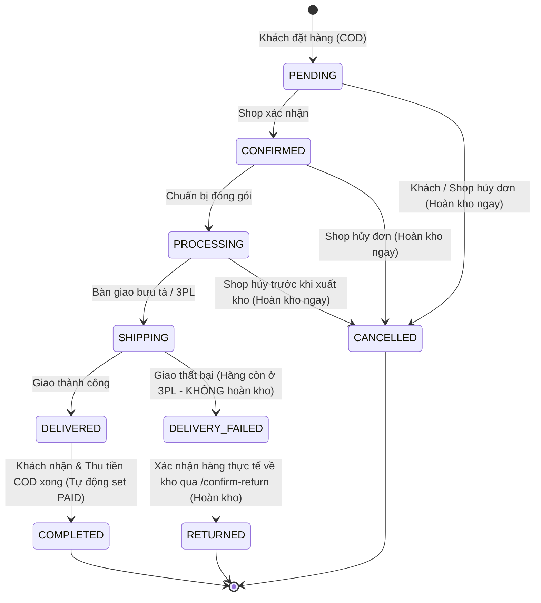

# Business Flows & State Machines

## 1. Catalog (Chuyên ngành Thời trang may mặc)
- **Duyệt và Lọc chuyên biệt cho thời trang**:
  - Chỉ sản phẩm `ACTIVE` và variant có trạng thái `ACTIVE` mới xuất hiện trên storefront.
  - Phân cấp danh mục thời trang: Khi chọn danh mục cha (ví dụ `Thời trang Nữ`), hệ thống tự động tải sản phẩm của danh mục cha và tất cả danh mục con (Đầm maxi, Chân váy, Áo blazer...).
  - Bộ lọc đa chiều:
    - Lọc theo Size: Danh sách kích thước may mặc phổ biến (XS, S, M, L, XL, XXL, FreeSize hoặc size số 28-34).
    - Lọc theo Màu sắc: Lọc theo mã màu Hex hoặc tên màu (Trắng, Đen, Be, Xanh Navy...).
    - Lọc theo Khoảng giá (`minPrice`, `maxPrice`).
    - Lọc theo Tình trạng tồn kho (`inStockOnly=true`).
  - Sắp xếp (Sorting) server-side với whitelist chặt chẽ: `newest` (mới nhất), `price_asc` (giá tăng dần), `price_desc` (giá giảm dần), `name_asc` (tên sản phẩm A-Z). Không chấp nhận param sort tùy tiện.
- **Trải nghiệm chọn biến thể thời trang (Product Detail Flow - Phase 5B & 5B.1 Hardening)**:
  - **Mở Lookbook Detail & Điều phối Lịch sử Web (Modal History Coordination Contract)**:
    - Khi click vào bất kỳ Product Card trên storefront (In-app navigation), hệ thống cập nhật query parameter `?product=<slug>` qua `window.history.pushState` đồng thời đính kèm `{ ...window.history.state, isProductModalPushed: true, product: slug }`.
    - Khi đóng modal được mở từ in-app, hệ thống gọi `window.history.back()` để pop state sạch sẽ, loại bỏ hoàn toàn vòng lặp lịch sử `[Catalog, Modal, Catalog]` khiến nút Back của trình duyệt bị kẹt.
    - Khi mở modal trực tiếp qua liên kết Deep-link (`/?product=<slug>`), state không có cờ `isProductModalPushed: true`. Khi đóng, hệ thống gọi `window.history.replaceState` để loại bỏ param `product`, bảo đảm không làm người dùng bị văng khỏi website.
    - Bảo tồn 100% các bộ lọc catalog hiện hành (`category`, `size`, `color`, `price`, `sort`, `search`) và WebGL Living Runway Canvas.
  - **Dynamic Gallery đồng bộ theo Màu & Fallback Minh bạch (Gallery Fallback)**:
    - Khi khách hàng chọn một **Màu sắc** (qua Color Swatches), hệ thống lọc danh sách ảnh: ưu tiên hiển thị ảnh gán riêng cho biến thể màu đó (`img.variantId === variant.id`), kết hợp với các ảnh chụp chung của sản phẩm (`!img.variantId`), sắp xếp theo `sortOrder`.
    - Nếu màu đó chưa có ảnh biến thể riêng và không có ảnh chung, hệ thống chỉ fallback về đúng 1 ảnh đại diện của sản phẩm kèm badge thông báo minh bạch: *"Ảnh minh họa kiểu dáng (Chưa có ảnh riêng cho màu [Tên màu])"*, tuyệt đối không hiển thị tràn ảnh của màu sắc khác.
  - **Bảo toàn Ý định Kích cỡ vs Giải quyết Biến thể Ma (Size Intent Preservation vs Ghost Variant Auto-resolution)**:
    - Trong ngành thời trang may mặc, kích cỡ phản ánh vóc dáng cơ thể của khách hàng. Khi khách đổi màu sắc:
      - Nếu kích cỡ hiện tại (`selectedSize`) **được sản xuất** ở màu mới: Hệ thống **bảo toàn kích cỡ đã chọn** (kể cả khi tồn kho `stock_quantity === 0`), hiển thị trạng thái "Tạm hết hàng" và đổi nút CTA sang "HẾT HÀNG" (disabled). Điều này ngăn chặn việc khách hàng bị âm thầm đổi sang kích cỡ khác không vừa vặn.
      - Nếu kích cỡ hiện tại **không được sản xuất** cho màu mới (Biến thể ma thực sự - Ghost Variant): Hệ thống mới tự động giải quyết (auto-resolve) sang kích cỡ khả dụng đầu tiên còn hàng (`stock_quantity > 0`), hoặc kích cỡ đầu tiên được sản xuất.
      - Biến thể không hoạt động (`status !== 'ACTIVE'`) bị loại trừ hoàn toàn khỏi danh sách biến thể hợp lệ.
  - **Bộ chọn Size 4 Trạng thái (4-State Size Selector)**:
    - `Active / Selected`: Size đang được chọn (viền vàng gold `#C7AD83`, nền đen, text trắng).
    - `In-Stock`: Size có tồn kho (`stock_quantity > 0`), có thể click chọn.
    - `Out-of-Stock`: Size có sản xuất cho màu này nhưng tạm hết hàng (`stock_quantity = 0`), hiển thị đường gạch chéo mờ và vô hiệu hóa click.
    - `Not Offered`: Size hoàn toàn không được sản xuất cho màu này, nút bị làm mờ sâu (`opacity-30`) và vô hiệu hóa click.
  - **Xử lý Phím Escape Phân tầng (Dual-Layer Escape Handling)**:
    - Khi Bảng tra cứu số đo (`SizeGuideDrawer`) trượt ra đè lên `ProductDetailModal`, phím `Escape` nhấn lần 1 chỉ đóng duy nhất `SizeGuideDrawer` nhờ cơ chế `e.stopImmediatePropagation()`, `e.stopPropagation()` và chốt chặn `isSizeGuideOpenRef` tại modal.
    - Nhấn phím `Escape` lần 2 mới đóng `ProductDetailModal` và hoàn trả URL sạch sẽ.
  - **Bảo vệ Hạn mức Số lượng Giỏ hàng (Cart Quantity Line Limit)**:
    - Đồng bộ với ràng buộc database và ADR-011: Mỗi dòng hàng tối đa 10 sản phẩm (`CHECK (quantity > 0 AND quantity <= 10)`).
    - Modal tự động đọc giỏ hàng hiện tại qua `useCart()`, xác định số lượng đã có của biến thể (`existingCartQuantity`), và tính toán `maxAddableQuantity = Math.min(Math.max(0, 10 - existingCartQuantity), variant.stockQuantity)`.
    - Bộ tăng giảm số lượng (stepper) và nút CTA tự động vô hiệu hóa khi người dùng đã đạt hạn mức 10 sản phẩm trong giỏ hoặc kho không còn hàng.
  - **Khả năng Tiếp cận & Bẫy Tiêu điểm (Modal Focus Containment - A11y)**:
    - Modal có đầy đủ `role="dialog"`, `aria-modal="true"`.
    - Khi mở modal, tự động focus vào nút đóng; phím `Tab` và `Shift+Tab` bị bẫy tuần hoàn bên trong các phần tử tương tác của modal; khi đóng modal, tiêu điểm được khôi phục chính xác về phần tử đã kích hoạt ban đầu.
  - **Luồng Thêm vào giỏ hàng (Add to Cart Workflow)**:
    - Khách hàng chưa đăng nhập (Guest): Bấm "THÊM VÀO GIỎ HÀNG" sẽ kích hoạt popup đăng nhập (`openAuthModal('login')`) kèm thông báo hướng dẫn.
    - Khách hàng đã đăng nhập: Gửi request `POST /api/v1/cart/items` với `variantId` đã giải quyết và số lượng hợp lệ (`effectiveQuantity`). Khi thành công, đóng modal sản phẩm và tự động mở mini-cart drawer (`openCart()`) để khách xem lại giỏ hàng và thanh toán mà không làm mất luồng trải nghiệm.
- **Quản lý ảnh sản phẩm**:
  - Ảnh tải lên có thứ tự `sort_order` và duy nhất 1 ảnh `is_primary = true`.
  - Validate định dạng ảnh (JPG, PNG, WebP), dung lượng tối đa và kích thước tối thiểu để đảm bảo tính thẩm mỹ chuẩn lookbook.
  - Khi liên kết ảnh với biến thể, ảnh bắt buộc phải thuộc cùng `product_id`.

## 2. Cart (Giỏ hàng thời trang)
1. Customer bắt buộc phải chọn đủ **Size** và **Màu sắc** trước khi bấm thêm vào giỏ.
2. Backend xác minh variant ID tương ứng với tổ hợp (Size, Color) đó tồn tại, đang `ACTIVE`, và `quantity` <= tồn kho hiện tại.
3. Backend thêm/cập nhật cart item, liên kết với variant cụ thể.
4. Khi xem cart, server trả thông tin snapshot thời gian thực: ảnh sản phẩm/variant, tên sản phẩm, size đã chọn, màu đã chọn, giá hiện tại và trạng thái còn hàng.
5. Giỏ hàng không giữ hàng (no reservation); khách hàng được cảnh báo tồn kho có thể hết nếu không thanh toán sớm.
6. Checkout kiểm tra lại giá, coupon, phí giao hàng và trừ tồn kho nguyên tử.

## 3. Checkout
1. Client gửi địa chỉ, phương thức giao hàng, coupon code (nếu có), payment method và các variant/quantity theo hợp đồng API.
2. Backend tải dữ liệu sản phẩm/variant từ DB; không tin tên, giá, discount, shipping fee hay total từ client.
3. Validate sản phẩm còn active, quantity, coupon, giới hạn sử dụng và địa chỉ.
4. Tính subtotal/discount/shipping/grand total trên server.
5. Trong transaction: kiểm tra/trừ tồn kho an toàn, tạo order + order items snapshot (chụp lại product_name, sku, size, color, unit_price tại thời điểm mua), tạo payment intent/record theo thiết kế.
6. Commit.
7. Với COD: order vào trạng thái phù hợp, ví dụ `PENDING_CONFIRMATION`.
8. Với gateway online: tạo payment request theo tài liệu provider, chuyển hướng hoặc hiển thị QR/flow tương ứng.
9. Nếu bước ngoài DB thất bại, có cơ chế xử lý trạng thái và hoàn tồn kho đã được định nghĩa; không để order/stock ở trạng thái mơ hồ.
10. Trả order number và trạng thái cho client.

## 4. Trạng thái đơn hàng & State Machine Vận hành Chủ shop (Phase 5C.0 - 5C.1)

Các trạng thái đơn hàng chuẩn mực trong hệ thống:
- `PENDING`: Đơn mới tạo, đang chờ shop xác nhận (khách hàng có thể tự hủy ở trạng thái này).
- `CONFIRMED`: Chủ shop đã tiếp nhận và xác nhận đơn hàng.
- `PROCESSING`: Nhân viên kho đang chuẩn bị, nhặt hàng và đóng gói sản phẩm.
- `SHIPPING`: Đã đóng gói và bàn giao cho bưu tá / đơn vị vận chuyển (3PL).
- `DELIVERED`: Đơn vị vận chuyển báo đã phát hàng thành công cho khách.
- `COMPLETED`: Đơn hàng hoàn tất, khách hàng hài lòng; với đơn COD, hệ thống tự động cập nhật `payment_status` từ `PENDING` sang `PAID`.
- `CANCELLED`: Đơn hàng bị hủy trước khi bàn giao vận chuyển (hoàn tồn kho nguyên tử + giải phóng quota coupon).
- `DELIVERY_FAILED`: Đơn vị vận chuyển giao hàng thất bại (khách từ chối nhận, không liên lạc được). **CHƯA** hoàn kho vì hàng còn trên đường vận chuyển.
- `RETURNED`: Kiện hàng đã được bưu tá chuyển hoàn thực tế về kho shop, chủ shop kiểm tra nguyên vẹn bao bì và xác nhận qua endpoint chuyên biệt `POST /confirm-return` (hoàn tồn kho nguyên tử + giải phóng coupon).

### Quy tắc Điều phối & An toàn Nghiệp vụ:
1. **Không cho client tự ý set status**: Mọi thao tác chuyển trạng thái phải đi qua `PATCH /api/v1/owner/orders/{orderNumber}/status` hoặc `POST /api/v1/owner/orders/{orderNumber}/confirm-return`.
2. **Khách hàng (`CUSTOMER`)**: Chỉ được phép hủy đơn của chính mình khi đơn đang ở trạng thái `PENDING`. Sau khi shop đã xác nhận (`CONFIRMED`), khách không thể tự hủy qua API mà phải liên hệ hỗ trợ.
3. **Chủ shop (`SHOP_OWNER`) & Quản trị viên (`ADMIN`)**:
   - Được phép chuyển đổi trạng thái tuần tự theo State Machine.
   - Khi chuyển trạng thái, giao diện Owner Portal bắt buộc hiển thị `OwnerActionConfirmModal` để cảnh báo hệ quả nghiệp vụ (ví dụ: cảnh báo hoàn tồn kho khi hủy đơn, cảnh báo trách nhiệm pháp lý khi bàn giao vận chuyển).
   - Mọi thao tác bắt buộc ghi kèm ghi chú (`note`) lưu vết vào bảng `order_status_history`.
4. **Bảo toàn Doanh thu COD**: Khi đơn COD chuyển sang `COMPLETED`, backend tự động chuyển `payment_status` sang `PAID`, bảo đảm khớp dữ liệu kế toán và đối soát dòng tiền.

## 5. Thanh toán
Trạng thái payment tách khỏi order status:
- `PENDING`, `SUCCESS`, `FAILED`, `CANCELLED`, `REFUND_PENDING`, `REFUNDED`.
- Redirect thành công trên browser không đủ để đánh dấu paid.
- Verify chữ ký webhook/IPN, amount, currency, merchant reference, order reference và trạng thái.
- Idempotency: cùng callback được gửi nhiều lần chỉ gây một hiệu ứng nghiệp vụ.
- Lưu mã giao dịch provider và kết quả đã lọc dữ liệu nhạy cảm.
- Không giữ transaction DB trong lúc chờ network call đến gateway.
- Chỉ xác nhận đơn theo chính sách sau sự kiện thanh toán đã được xác thực.
- COD có payment status riêng như `PENDING` rồi `SUCCESS` khi thu tiền, theo quy ước thống nhất.

## 6. Hủy đơn và tồn kho
- Xác định rõ ai được hủy và đến thời điểm nào.
- Việc hủy phải idempotent; không hoàn kho hai lần.
- Nếu đã thanh toán, không giả vờ đã hoàn tiền chỉ vì order status là CANCELLED.
- Tách yêu cầu hoàn tiền khỏi xác nhận hoàn tiền thật từ provider/thao tác kế toán.
- Ghi lịch sử thay đổi.

### Hàng hoàn do giao hàng thất bại (luồng hiện có)
- `SHIPPING -> DELIVERY_FAILED` chưa hoàn tồn kho hoặc giải phóng coupon vì hàng vẫn có thể ở đơn vị vận chuyển.
- Chỉ `SHOP_OWNER` hoặc `ADMIN` xác nhận hàng thực tế đã về kho qua `POST /api/v1/owner/orders/{orderNumber}/confirm-return`. Trong cùng transaction có khóa đơn: chuyển `DELIVERY_FAILED -> RETURNED`, hoàn tồn từng SKU, đổi lượt coupon `APPLIED -> RELEASED` nếu có và ghi một lần chuyển trạng thái vào lịch sử.
- API PATCH trạng thái chung từ chối đích `RETURNED` bằng HTTP 400, mã `RETURN_CONFIRMATION_REQUIRED`; không thay đổi đơn, tồn kho, coupon hoặc lịch sử. Giữ cạnh `DELIVERY_FAILED -> RETURNED` trong enum vòng đời cho use case xác nhận chuyên dụng.
- Xác nhận hàng hoàn lần hai trả HTTP 400, mã `INVALID_TRANSITION`; không hoàn kho, giải phóng coupon hoặc ghi lịch sử thêm lần nữa. Luồng này xử lý hàng giao thất bại, không mở rộng chính sách đổi/trả sau giao thành công.

## 7. Coupon
- Kiểm tra thời gian hiệu lực, minimum spend, tổng usage limit, per-user limit, loại giảm giá, mức giảm tối đa.
- Chặn tổng discount vượt subtotal theo policy.
- Cần bảo vệ cạnh tranh khi coupon chỉ còn một lượt; xử lý trong transaction.
- Không áp dụng coupon chỉ bằng validation frontend.

## 8. Các lỗi triển khai thật cần test
- Hai khách mua variant cuối cùng cùng lúc.
- Client gửi giá 1 đồng hoặc total âm.
- Coupon hết hạn ngay lúc checkout.
- Gateway timeout sau khi order đã tạo.
- Webhook đến hai lần hoặc đến sai thứ tự.
- Khách refresh trang kết quả thanh toán.
- Shop hủy đơn đã bàn giao.
- Sản phẩm bị ẩn sau khi nằm trong cart.
- Upload ảnh thành công nhưng DB save thất bại và ngược lại.
- Email provider lỗi nhưng order vẫn được ghi nhận.
- Customer A cố truy cập order của Customer B.
- Shop owner thử sửa sản phẩm/đơn không thuộc shop.
