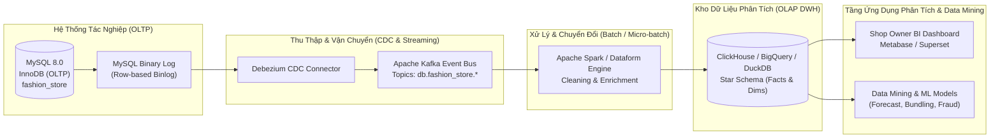
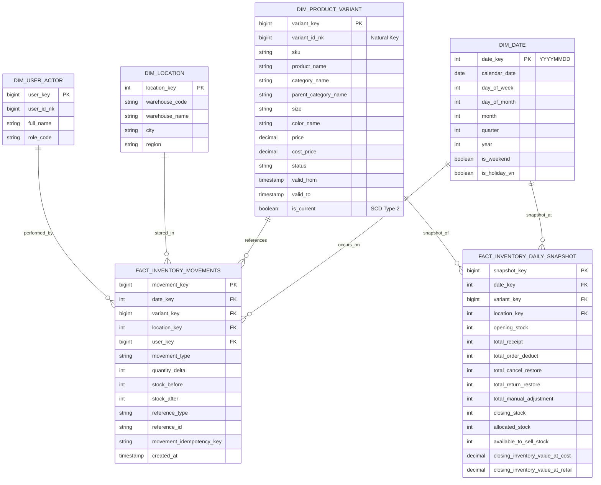

# Báo Cáo Thiết Kế Kiến Trúc Phân Tích Dữ Liệu & Data Mining
## Hệ Thống E-Commerce FashionStore — Modular Monolith

**Ngày lập**: 29/10/2026  
**Phiên bản**: 1.0.0  
**Tác giả**: Đội ngũ Kiến trúc Hệ thống & Kỹ thuật Dữ liệu FashionStore  
**Đối tượng**: Hội đồng Đánh giá Bài tập lớn / Khóa luận tốt nghiệp & Đội ngũ Phát triển

---

## 1. Đặt Vấn Đề & Bối Cảnh Nghiệp Vụ

Trong các hệ thống thương mại điện tử truyền thống hoạt động dưới mô hình **Online Transaction Processing (OLTP)**, cơ sở dữ liệu quan hệ được tối ưu hóa chuẩn tắc (3NF / BCNF) nhằm đảm bảo tính toàn vẹn **ACID**, độ trễ ghi thấp và an toàn giao dịch đồng thời. Tuy nhiên, khi hệ thống mở rộng, các câu hỏi nghiệp vụ chiến lược không thể giải quyết hiệu quả bằng các truy vấn trực tiếp trên tầng OLTP:

1. **Hiệu suất chu chuyển tồn kho**: Biến thể sản phẩm (SKU) nào có tốc độ bán (Stock Velocity) cao nhất? Thời gian trung bình để thanh lý một lô hàng là bao lâu?
2. **Nguy cơ đứt gãy chuỗi cung ứng**: Tần suất hết hàng (Stockout Frequency) ảnh hưởng như thế nào đến doanh thu bị bỏ lỡ (Lost Sales Opportunity)?
3. **Phân tích hành vi hoàn hàng**: Nhóm khách hàng hoặc khu vực địa lý nào có tỷ lệ hoàn hàng COD (Return-to-Origin - RTO) bất thường? Nguyên nhân do kích cỡ không vừa hay lỗi hoàn thiện sản phẩm?
4. **Cá nhân hóa Lookbook & Bán chéo (Cross-selling)**: Khi khách hàng chọn một chiếc đầm lụa, những phụ kiện, áo khoác hoặc giày dép nào thường được mua cùng nhau trong cùng một đơn hàng?

Việc chạy các truy vấn tính toán tổng hợp phức tạp (Aggregation, Window Functions, Self-Joins) trên cơ sở dữ liệu tác nghiệp OLTP sẽ gây khóa bảng, cạn kiệt tài nguyên kết nối (Connection Pool Exhaustion) và làm suy giảm trực tiếp trải nghiệm thanh toán của khách hàng. Do đó, việc xây dựng một **Analytical Data Warehouse (DWH)** tách biệt cùng đường ống **ETL / ELT** và các mô hình **Data Mining / Machine Learning** là yêu cầu cấp thiết.

---

## 2. Kiến Trúc Đường Ống Dữ Liệu Phân Tích (ETL / ELT Architecture)

Kiến trúc phân tích dữ liệu của FashionStore được thiết kế theo mô hình **Modern Data Stack** tách rời giữa lưu trữ và tính toán:

### Các thành phần chính trong đường ống:
1. **Change Data Capture (CDC)**: Sử dụng **Debezium** lắng nghe binlog của MySQL 8.0, bắt trọn từng sự kiện `INSERT`, `UPDATE` của bảng `inventory_movements`, `orders`, `order_items` với độ trễ dưới 1 giây (sub-second latency) mà không gây tải truy vấn lên cơ sở dữ liệu tác nghiệp.
2. **Message Broker**: **Apache Kafka** đảm bảo tính đệm chịu lỗi (fault-tolerant buffering) và phân phối sự kiện cho nhiều bên tiêu thụ (multi-consumer).
3. **Data Processing Engine**: **Apache Spark** (hoặc Dataform trên Google Cloud) định kỳ tổng hợp dữ liệu theo giờ/ngày, tính toán các chỉ số phái sinh và nạp vào Data Warehouse.
4. **OLAP Storage**: Cơ sở dữ liệu hướng cột (**ClickHouse** cho self-hosted on-premise hoặc **Google BigQuery** cho triển khai Cloud) cho phép quét hàng chục triệu bản ghi biến động trong vài phần nghìn giây.

---

## 3. Mô Hình Dữ Liệu Phân Tích Hình Sao (Star Schema DWH)

Trong Data Warehouse, dữ liệu được mô hình hóa theo cấu trúc **Star Schema** tập trung vào các sự kiện biến động kho và ảnh chụp số dư định kỳ:

### Thiết kế bảng Fact & Dimension:
- **`DIM_PRODUCT_VARIANT` (Slowly Changing Dimension Type 2 - SCD 2)**: Lưu trữ lịch sử thay đổi thông tin sản phẩm và phân loại (giá niêm yết, danh mục). Khi biến thể thay đổi giá hoặc thông số, bản ghi mới được thêm với `valid_from` và `valid_to` mới, bảo toàn độ chính xác cho các báo cáo doanh thu quá khứ.
- **`FACT_INVENTORY_MOVEMENTS` (Transaction Fact Table)**: Lưu từng giao dịch ghi nhận từ Sổ cái Kiểm toán bất biến (`inventory_movements`), hỗ trợ truy vết tức thì chi tiết từng thao tác.
- **`FACT_INVENTORY_DAILY_SNAPSHOT` (Periodic Snapshot Fact Table)**: Lưu ảnh chụp trạng thái kho chốt sổ vào lúc 23:59:59 mỗi ngày. Giúp các truy vấn tổng hợp theo tháng, quý, năm chạy nhanh gấp hàng trăm lần so với việc tính lũy kế toàn bộ bảng giao dịch.

---

## 4. Các Chỉ Số Vận Hành Tồn Kho Trọng Yếu (Operational Inventory Metrics)

### 4.1. Tốc Độ Chu Chuyển Tồn Kho (Inventory Turnover Ratio - ITR)
Đo lường số lần tồn kho bình quân được bán hết và thay thế trong một khoảng thời gian (thường là 1 năm hoặc 1 quý):
$$\text{ITR} = \frac{\text{Giá vốn hàng bán (Cost of Goods Sold - COGS)}}{\text{Giá trị tồn kho bình quân (Average Inventory Value)}}$$

$$\text{Số ngày tồn kho bình quân (Days Sales of Inventory - DSI)} = \frac{365}{\text{ITR}}$$
* **Ý nghĩa thực tế**: DSI của ngành thời trang cao cấp thường nằm trong khoảng $45 - 60$ ngày. DSI vượt quá 90 ngày cảnh báo nguy cơ ứ đọng hàng tồn (Dead Stock) và lỗi mốt, đòi hỏi shop owner phải kích hoạt chương trình khuyến mãi giảm giá.

### 4.2. Tần Suất & Thời Lượng Đứt Hàng (Stockout Frequency & Stockout Duration)
$$\text{Tỷ lệ đứt hàng (Stockout Rate)} = \frac{\sum \text{Số ngày biến thể có ATS} = 0}{\text{Tổng số ngày trong chu kỳ}} \times 100\%$$

$$\text{Doanh thu ước tính bị bỏ lỡ (Lost Sales)} = \sum_{t \in \text{Stockout Days}} \overline{S}_{\text{daily}} \times P_{\text{retail}}$$
Trong đó $\overline{S}_{\text{daily}}$ là lượng bán bình quân mỗi ngày khi sản phẩm còn hàng.

### 4.3. Tỷ Lệ Bán Hết (Sell-Through Rate - STR)
$$\text{STR} = \frac{\text{Số lượng đã bán thực tế}}{\text{Số lượng nhập ban đầu} + \text{Số lượng nhập bổ sung}} \times 100\%$$
* **Ngưỡng hành động**: Biến thể có $\text{STR} > 80\%$ trong 4 tuần đầu tiên được gắn nhãn **"Best Seller"** và tự động sinh đề xuất nhập kho bổ sung. Biến thể có $\text{STR} < 30\%$ được phân tích để tối ưu hình ảnh Lookbook hoặc giảm giá thanh lý.

### 4.4. Tỷ Lệ Hoàn Hàng Theo Biến Thể & Khu Vực (Return-to-Origin Rate - RTO)
$$\text{RTO Rate} = \frac{\text{Số lượng hoàn trả (RETURN\_RESTORE)}}{\text{Số lượng đã xuất bán (ORDER\_DEDUCT)}} \times 100\%$$
* **Phân tích nguyên nhân**: RTO phân rã theo size giúp nhận diện form dáng thiết kế có chuẩn hay không. Ví dụ: Nếu Size M của Áo Polo có RTO lên tới $35\%$ với lý do "Chật vai", xưởng may cần hiệu chỉnh lại rập thiết kế.

### 4.5. Tỷ Lệ Hao Hụt & Sai Lệch Kiểm Kê (Inventory Shrinkage Rate)
$$\text{Shrinkage Rate} = \frac{\sum |\Delta_{\text{MANUAL\_ADJUSTMENT negative}}|}{\text{Tổng tồn kho sổ sách}} \times 100\%$$
* **Kiểm toán an ninh**: Phát hiện thất thoát vật lý, rách xước sợi vải hoặc gian lận trong khâu vận hành đóng gói.

---

## 5. Ứng Dụng Thuật Toán Data Mining & Machine Learning

### 5.1. Dự Báo Nhu Cầu & Tồn Kho Tối Ưu (Demand Forecasting)
* **Bài toán**: Dự báo số lượng tiêu thụ của từng biến thể SKU trong 14 ngày tới để hỗ trợ chủ shop lên kế hoạch đặt hàng xưởng may.
* **Mô hình đề xuất**: **LightGBM Regressor** kết hợp chuỗi thời gian **Prophet / Temporal Fusion Transformer (TFT)**.
* **Đặc trưng đầu vào (Feature Engineering)**:
  - Lịch sử lượng bán 7, 14, 30 ngày gần nhất (Lag features).
  - Biến mùa vụ: Thứ trong tuần, ngày trong tháng, tháng trong năm, ngày lễ/Tết.
  - Tác động Marketing: Có nằm trong Lookbook trang chủ hay không, giảm giá bao nhiêu %, mã voucher đang áp dụng.
  - Phân bố size đường cong thời trang (Size Curve: tỷ lệ tiêu chuẩn $S:M:L:XL = 2:4:3:1$).

### 5.2. Khai Phá Luật Kết Hợp Cho Gợi Ý Lookbook (Association Rule Mining - Market Basket Analysis)
* **Bài toán**: Tự động phát hiện các cặp sản phẩm thường xuyên xuất hiện cùng nhau trong các đơn hàng để xây dựng tính năng "Complete the Look" (Phối đồ đồng bộ).
* **Thuật toán**: **FP-Growth (Frequent Pattern Growth)** hoặc **Apriori Algorithm**.
* **Độ đo đánh giá**:
  - **Support** $P(A \cap B)$: Xác suất cả $A$ và $B$ cùng có trong giỏ hàng.
  - **Confidence** $P(B|A) = \frac{P(A \cap B)}{P(A)}$: Xác suất khách mua $B$ khi đã chọn $A$.
  - **Lift** $\frac{P(A \cap B)}{P(A) \times P(B)}$: Tỷ lệ tương quan vượt trội so với lựa chọn ngẫu nhiên ($\text{Lift} > 1.5$ biểu thị mối quan hệ kết hợp chặt chẽ).
* **Ví dụ ứng dụng**: Khai phá từ 10.000 đơn hàng thực tế:
  $$\text{Áo Sơ Mi Lụa Dài Tay} \implies \text{Quần Tây Cạp Cao Ống Suông} \quad (\text{Confidence: } 68\%, \text{Lift: } 2.4)$$
  Gợi ý ngay cụm Lookbook này trên trang chi tiết sản phẩm để tăng giá trị đơn hàng trung bình (Average Order Value - AOV).

### 5.3. Phát Hiện Bất Thường Trong Biến Động Kho (Anomaly Detection on Audit Movements)
* **Bài toán**: Cảnh báo sớm các hành vi điều chỉnh kiểm kê bất thường hoặc nghi vấn gian lận nội bộ.
* **Mô hình**: **Isolation Forest** hoặc **Autoencoder**.
* **Dấu hiệu bất thường (Anomalies)**:
  - Một tài khoản thực hiện nhiều lần `MANUAL_ADJUSTMENT` âm sát ngưỡng cho phép trong thời gian ngắn.
  - Tỷ lệ hàng hoàn `RETURN_RESTORE` tập trung đột biến vào một shipper hoặc một khu vực giao hàng cụ thể.
  - Độ trễ bất thường giữa thời điểm giao thất bại (`DELIVERY_FAILED`) và thời điểm hoàn về kho (`RETURNED`).

---

## 6. Lộ Trình Triển Khai Thực Nghiệm (Implementation Roadmap)

| Giai đoạn | Mục tiêu | Công nghệ chính | Kết quả đầu ra |
|:---|:---|:---|:---|
| **Phase A** (Hiện tại) | Nền tảng dữ liệu giao dịch chuẩn xác & Sổ cái bất biến | MySQL 8.0, Flyway V8, Spring Boot 3 | `inventory_movements` ghi nhận 100% biến động, zero discrepancy |
| **Phase B** | Xây dựng Star Schema DWH & Báo cáo BI cơ bản | DuckDB / ClickHouse, Metabase | Báo cáo ITR, DSI, Sell-through rate cho Shop Owner |
| **Phase C** | Xây dựng đường ống CDC Streaming tự động | Debezium, Apache Kafka, Spark | Đồng bộ dữ liệu real-time từ OLTP sang OLAP |
| **Phase D** | Tích hợp Data Mining & Machine Learning | Python, LightGBM, MLflow, FP-Growth | Dự báo nhu cầu 14 ngày & Gợi ý phối đồ Lookbook tự động |

---

## 7. Kết Luận
Việc xây dựng thành công **Sổ cái Kiểm toán Tồn kho Bất biến (Phase 5C.3)** là bước đi nền tảng mang tính quyết định. Nó cung cấp nguồn dữ liệu chân thực và đáng tin cậy nhất (**Single Source of Truth**) để triển khai hệ sinh thái phân tích dữ liệu chuyên sâu, phục vụ mục tiêu vận hành xuất sắc và đáp ứng các tiêu chuẩn học thuật khắt khe của một đồ án công nghệ thông tin chuyên ngành.

