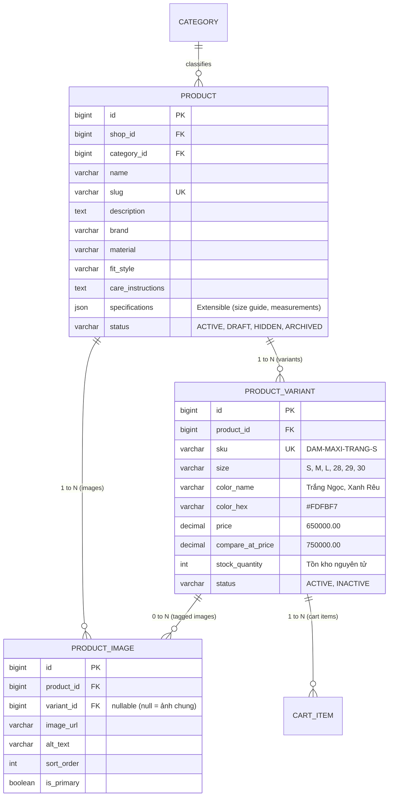
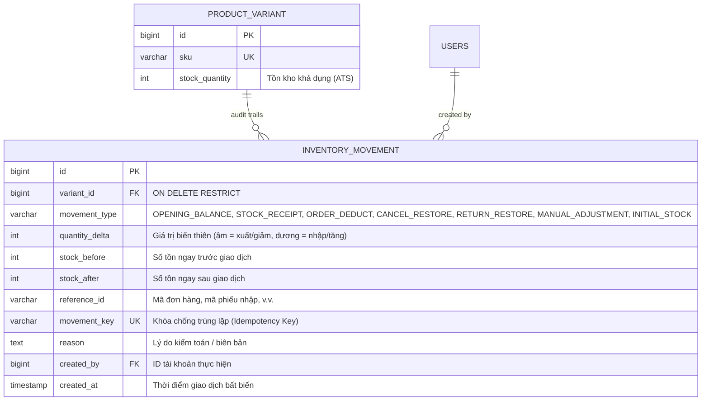

# Domain Model & Data Design

Đây là mô hình khởi đầu cần được xác minh khi thiết kế từng feature. Agent phải đề xuất ERD/migration trước khi triển khai schema lớn.

## 1. Các bảng đề xuất

### Identity & customer
- `users`: id, email (unique chuẩn hóa), password_hash, full_name, phone, status, created_at, updated_at.
- `roles`: id, code (`CUSTOMER`, `SHOP_OWNER`, `ADMIN`).
- `user_roles`: user_id, role_id.
- `customer_addresses`: user_id, recipient_name, phone, province/district/ward/address_line, is_default.
- `shops`: id, name, slug, status, owner_user_id, created_at. MVP chỉ có một shop active; giữ shop_id ở các bảng shop-owned nếu điều này giúp mở rộng thực tế.

### Catalog (Chuyên biệt ngành Thời trang & Trang phục)
- `categories`:
  - `id`: BIGINT AUTO_INCREMENT PRIMARY KEY.
  - `parent_id`: BIGINT nullable, FK đến `categories(id)` (có ràng buộc `parent_id != id` và không tạo chu trình lặp).
  - `name`: VARCHAR(100) NOT NULL.
  - `slug`: VARCHAR(120) NOT NULL UNIQUE.
  - `description`: TEXT nullable.
  - `status`: VARCHAR(20) DEFAULT 'ACTIVE' (`ACTIVE`, `INACTIVE`).
  - `sort_order`: INT DEFAULT 0.
  - *Cấu trúc danh mục thời trang thực tế*:
    - Thời trang Nữ: Đầm & Váy (Đầm maxi, đầm dự tiệc, chân váy chữ A, chân váy midi), Áo nữ (Áo sơ mi, áo thun, croptop, blazer), Quần nữ (Quần jeans, quần tây ống suông, quần short), Trang phục phối bộ (Jumpsuit, set đồ dạo phố, set đồ công sở).
    - Thời trang Nam: Áo nam (Áo polo, áo sơ mi, áo thun basic, áo khoác), Quần nam (Quần jeans, quần tây, quần kaki, quần short).
- `products`:
  - `id`: BIGINT AUTO_INCREMENT PRIMARY KEY.
  - `shop_id`: BIGINT NOT NULL, FK đến `shops(id)`.
  - `category_id`: BIGINT NOT NULL, FK đến `categories(id)`.
  - `name`: VARCHAR(255) NOT NULL.
  - `slug`: VARCHAR(280) NOT NULL UNIQUE.
  - `description`: TEXT nullable (mô tả kiểu dáng, hoàn cảnh sử dụng: dạo phố, công sở, dự tiệc).
  - `brand`: VARCHAR(100) nullable.
  - `material`: VARCHAR(150) nullable (chất liệu vải: 100% Cotton, Lụa Satin, Linen tơ tằm, Kaki co giãn...).
  - `fit_style`: VARCHAR(100) nullable (form dáng: Slim fit, Regular fit, Oversized, Dáng chữ A, Dáng xòe...).
  - `care_instructions`: TEXT nullable (hướng dẫn giặt ủi: Giặt tay, không giặt sấy nhiệt độ cao, ủi ở nhiệt độ trung bình...).
  - `specifications`: JSON nullable (lưu thông số kỹ thuật mở rộng linh hoạt theo nhóm trang phục như độ co giãn, độ dày vải, chiều dài váy/quần, bảng kích thước mẫu ngực/eo/mông).
  - `status`: VARCHAR(20) DEFAULT 'DRAFT' (`DRAFT`, `ACTIVE`, `HIDDEN`, `ARCHIVED`).
  - `created_at`, `updated_at`: TIMESTAMP.
- `product_variants`:
  - `id`: BIGINT AUTO_INCREMENT PRIMARY KEY.
  - `product_id`: BIGINT NOT NULL, FK đến `products(id)`.
  - `sku`: VARCHAR(60) NOT NULL UNIQUE (định dạng gợi nhớ: `{PRODUCT_SLUG}-{COLOR}-{SIZE}`, ví dụ `DAM-MAXI-LUA-TRANG-M`).
  - `size`: VARCHAR(20) NOT NULL (kích cỡ may mặc: XS, S, M, L, XL, XXL, FreeSize hoặc size số 28, 29, 30, 31, 32).
  - `color_name`: VARCHAR(50) NOT NULL (tên màu sắc: Trắng kem, Đen tuyền, Xanh Navy, Be, Hồng Pastel...).
  - `color_hex`: VARCHAR(7) nullable (mã màu Hex dạng `#FFFFFF` phục vụ hiển thị Color Swatch trực quan).
  - `price`: DECIMAL(12,2) NOT NULL (giá bán hiện hành, > 0).
  - `compare_at_price`: DECIMAL(12,2) nullable (giá niêm yết/giá gốc dùng để hiển thị giá gạch ngang khuyến mãi, >= price).
  - `stock_quantity`: INT NOT NULL DEFAULT 0 (tồn kho nguyên tử, >= 0).
  - `status`: VARCHAR(20) DEFAULT 'ACTIVE' (`ACTIVE`, `INACTIVE`).
  - `created_at`, `updated_at`: TIMESTAMP.
  - *Ràng buộc tính toàn vẹn*:
    - `UNIQUE KEY uk_product_size_color (product_id, size, color_name)` (chặn tạo 2 biến thể trùng tổ hợp size và màu trong cùng một sản phẩm).
    - `UNIQUE KEY uk_product_variant_composite (product_id, id)` (dùng làm đích tham chiếu composite FK cho ảnh).
- `product_images`:
  - `id`: BIGINT AUTO_INCREMENT PRIMARY KEY.
  - `product_id`: BIGINT NOT NULL, FK đến `products(id)`.
  - `variant_id`: BIGINT nullable, FK đến `product_variants(id)`.
  - `image_url`: VARCHAR(500) NOT NULL.
  - `storage_key`: VARCHAR(255) NOT NULL (public ID lưu trên Cloudinary/S3 để quản lý vòng đời file).
  - `alt_text`: VARCHAR(255) nullable (mô tả ảnh cho SEO và trợ năng accessibility).
  - `sort_order`: INT DEFAULT 0 (thứ tự hiển thị trong bộ sưu tập gallery).
  - `is_primary`: BOOLEAN NOT NULL DEFAULT FALSE (ảnh đại diện chính cho sản phẩm trên card catalog).
  - `file_size`: BIGINT nullable (kích thước tệp tính bằng bytes).
  - `width`: INT nullable (chiều rộng pixel của hình ảnh).
  - `height`: INT nullable (chiều cao pixel của hình ảnh).
  - `format`: VARCHAR(20) nullable (định dạng ảnh: jpg, png, webp, avif).
  - `created_at`: TIMESTAMP.
  - *Ràng buộc toàn vẹn ảnh*:
    - `CONSTRAINT fk_image_product_variant FOREIGN KEY (product_id, variant_id) REFERENCES product_variants(product_id, id) ON DELETE CASCADE` (đảm bảo variant_id nếu gán thì bắt buộc phải thuộc cùng sản phẩm đó, không thể trỏ chéo sang sản phẩm khác).
    - Mỗi sản phẩm có tối đa 1 ảnh `is_primary = true` (được đảm bảo bằng transactional application service logic).

### Kiến trúc thuộc tính thời trang (Fashion Attribute Architecture)
- **TỪ CHỐI EAV / Generic Attribute Engine**: Tuyệt đối không xây dựng các bảng thuộc tính động tổng quát (`attributes`, `attribute_values`, `product_attribute_values`) trong MVP. Mô hình EAV khiến câu lệnh query trở nên cực kỳ cồng kềnh với nhiều phép `LEFT JOIN`, làm suy giảm nghiêm trọng hiệu năng indexing, phân trang và sắp xếp.
- **Mô hình Quan hệ kết hợp JSON (Pragmatic Relational + JSON)**:
  - `size` và `color_name` / `color_hex` được lưu bằng cột quan hệ chuẩn trong `product_variants` để tối ưu hóa indexing, tìm kiếm, lọc nhanh theo kích cỡ/màu sắc và kiểm tra tồn kho nguyên tử lúc đặt hàng.
  - Các thuộc tính định danh thời trang chung (`material`, `fit_style`, `care_instructions`) được lưu thành các cột chuẩn trong `products`.
  - Các thông số mô tả chuyên biệt cho từng dòng trang phục (ví dụ: độ dài đầm, độ co giãn sợi vải, số đo 3 vòng mẫu của size guide) được lưu trong trường `specifications` dạng JSON của bảng `products`.
- **Ranh giới ngành hàng**:
  - MVP chỉ tập trung 100% vào thời trang may mặc và trang phục (quần, áo, đầm, váy, áo khoác, jumpsuit, set đồ).
  - Loại bỏ hoàn toàn các thực thể, thuộc tính hoặc seed data liên quan đến đồng hồ, đồ điện tử, trang sức kim hoàn hay đồ gia dụng.

### 1.1. Chi tiết Quan hệ Cốt lõi: Product → ProductVariant → ProductImage (Phase 5B)



#### Nguyên lý Thiết kế & Trả lời các câu hỏi nghiệp vụ:
1. **Một Product có bao nhiêu Variant?**
   - Một Product có thể có nhiều Variant (quan hệ `@OneToMany`, 1-N). Mỗi variant đại diện cho một SKU cụ thể (tổ hợp của Size và Màu sắc). Ví dụ: Đầm Lụa Maxi có 5 variants (Trắng Ngọc: S/M/L; Xanh Rêu Nhạt: S/M).
2. **Size và Color ảnh hưởng thế nào tới SKU?**
   - SKU (Stock Keeping Unit) là mã định danh duy nhất cho từng đơn vị lưu kho cụ thể ở cấp độ `(product_id, size, color_name)`. Trong database, tính toàn vẹn được bảo vệ bởi hai ràng buộc:
     - `UNIQUE KEY uk_variants_sku (sku)`
     - `UNIQUE KEY uk_product_size_color (product_id, size, color_name)` (chặn tuyệt đối việc tạo 2 dòng variant trùng size và màu trong cùng một sản phẩm).
3. **Ảnh sản phẩm liên kết với Product hay từng Variant?**
   - Bảng `product_images` chứa `product_id NOT NULL` và `variant_id NULLABLE`.
   - Ràng buộc khóa ngoại phức hợp `CONSTRAINT fk_images_product_variant FOREIGN KEY (product_id, variant_id) REFERENCES product_variants (product_id, id) ON DELETE CASCADE` đảm bảo ảnh nếu được gán `variant_id` thì variant đó bắt buộc phải thuộc cùng sản phẩm đó, không thể trỏ chéo sang sản phẩm khác.
   - **Ảnh chung (`variant_id IS NULL`)**: Là ảnh chụp lookbook toàn cảnh, phối đồ phong cách hoặc ảnh người mẫu mặc chung cho mọi màu sắc.
   - **Ảnh theo biến thể (`variant_id IS NOT NULL`)**: Là ảnh chụp góc cạnh, mặt trước, mặt sau hoặc thớ vải cận cảnh riêng cho màu sắc/biến thể đó.
4. **Một màu có nhiều ảnh nhưng nhiều size dùng chung ảnh thì dữ liệu được lưu thế nào?**
   - Trong dữ liệu thời trang, ảnh thường thay đổi theo **Màu sắc**, không thay đổi theo kích cỡ (Size S hay Size L đều mặc cùng một màu vải).
   - Trong schema, `variant_id` trong `product_images` trỏ tới một variant đại diện cho màu đó (thường là variant đầu tiên của màu, ví dụ size S).
   - Khi frontend hiển thị gallery cho màu sắc đang chọn:
     - Hệ thống gom toàn bộ `variant_id` của các biến thể có cùng `color_name` thành một tập hợp `variantIdsOfColor`.
     - Lọc các ảnh trong `product.images` có `img.variantId` nằm trong tập hợp này, kết hợp cùng các ảnh chung (`!img.variantId`).
     - Nếu một màu chưa có ảnh riêng, gallery tự động fallback hiển thị toàn bộ ảnh của sản phẩm.
5. **Tồn kho được quản lý ở cấp Product hay ProductVariant?**
   - Tồn kho (`stock_quantity`) được quản lý nghiêm ngặt và nguyên tử ở cấp `ProductVariant`.
   - Cấp `Product` không lưu số tồn kho tổng cứng để tránh bẫy bất đồng bộ (denormalization desync). Thuộc tính `isOutOfStock()` của Product là một hàm phái sinh: trả về `true` khi và chỉ khi toàn bộ các variant active của sản phẩm đều có `stock_quantity <= 0`.
6. **Khi người dùng chuyển màu, những size nào còn hợp lệ?**
   - Mỗi màu có thể có danh sách size khác nhau (Asymmetric sizes). Ví dụ: Áo thun màu Trắng có S, M, L; nhưng màu Đen Than chỉ có M, L; màu Xanh Rêu chỉ có L.
   - Khi người dùng đổi màu (ví dụ từ Trắng sang Đen Than khi đang chọn size S), nếu hệ thống giữ nguyên size S thì tổ hợp `(Đen Than, S)` không tồn tại trong DB, dẫn đến lỗi "Ghost Variant" (biến thể ma).
   - Giải pháp: Khi đổi màu, hệ thống tự động kiểm tra xem size hiện tại có tồn tại trong màu mới không. Nếu không, lập tức tự động chuyển sang size hợp lệ đầu tiên của màu mới (ưu tiên size còn hàng).
7. **Khi variant hết hàng, hành động Add to Cart phải xử lý ra sao?**
   - Nút CTA chuyển sang trạng thái disabled hiển thị nhãn "HẾT HÀNG".
   - Nút tăng số lượng stepper bị vô hiệu hóa.
   - Cấp backend `CartService.validateSellable()` kiểm tra tồn kho và trạng thái active của variant trước khi cho phép lưu vào giỏ hàng.

### Cart & promotion
- `carts`: id, user_id nullable (nếu hỗ trợ guest cart persistence), status, created_at, updated_at.
- `cart_items`: id, cart_id, variant_id, quantity; unique(cart_id, variant_id).
- `coupons`: id, code unique, discount_type, discount_value, min_order_amount, max_discount nullable, starts_at, expires_at, usage_limit, per_user_limit, status.
- `coupon_redemptions`: coupon_id, user_id, order_id, redeemed_at.

### Order & payment
- `orders`: id/public_order_number (`ORD-YYYYMMDD-XXXX`), user_id, status, payment_status, payment_method, subtotal, discount_total, shipping_fee, grand_total, coupon_id nullable, shipping snapshot fields (recipient_name, phone, address_line, ward, district, province), note nullable, created_at, updated_at.
  - *Kiến trúc Đơn hàng & Cửa hàng (Phase 5C.0 Analysis)*: Bảng `shops` lưu thông tin boutique store (`id = 1`, `IVRE Atelier`). Các bảng `products` gắn `shop_id = 1`. Trong kiến trúc hiện tại, bảng `orders` phục vụ đơn hàng của boutique duy nhất này; tầng nghiệp vụ `OwnerOrderService` thực hiện lọc và bảo vệ ranh giới dữ liệu shop.
- `order_items`: id, order_id, variant_id nullable, product_name_snapshot, sku_snapshot, size_snapshot, color_snapshot, unit_price_snapshot, quantity, line_total.
  - *Tại sao bắt buộc snapshot bất biến?*: Hóa đơn mua sắm là chứng từ tài chính và pháp lý có giá trị vĩnh viễn. Nếu chỉ trỏ FK tới `product_variants`, mọi thay đổi sau này của chủ shop (sửa tên sản phẩm, tăng/giảm giá, đổi mã SKU, hoặc ngừng kinh doanh một size) sẽ làm biến dạng hóa đơn trong quá khứ hoặc vi phạm toàn vẹn dữ liệu. Bằng cách lưu snapshot `product_name_snapshot`, `sku_snapshot`, `size_snapshot`, `color_snapshot`, `unit_price_snapshot`, hóa đơn được bảo toàn 100% nguyên trạng kể cả khi sản phẩm gốc bị xóa hoặc chỉnh sửa.
- `payments`: id, order_id, provider, provider_transaction_id nullable, amount, status, idempotency/provider reference, created_at, updated_at.
- `order_status_history`: id, order_id, old_status, new_status, actor_user_id nullable, note, created_at.
  - *Tại sao bảng này tối quan trọng?*:
    1. **Truy xuất nguồn gốc & Trách nhiệm giải trình (Audit Trail & Accountability)**: Ghi lại chính xác ai (Customer, Shop Owner hay Admin) đã chuyển trạng thái, vào thời điểm nào, kèm theo ghi chú nghiệp vụ.
    2. **Minh bạch với Khách hàng**: Khách hàng và Chủ shop có thể xem toàn bộ dòng thời gian (vertical timeline) từ lúc đặt hàng, qua các khâu xử lý, đóng gói, bàn giao vận chuyển đến khi phát thành công.
    3. **Phòng vệ Tranh chấp & Khiếu nại Vận chuyển**: Phân định rạch ròi giữa thời điểm đơn vị vận chuyển báo giao thất bại (`SHIPPING -> DELIVERY_FAILED`) và thời điểm kiện hàng thực tế được chuyển hoàn về kho shop (`DELIVERY_FAILED -> RETURNED`).
- Có thể thêm `payment_webhook_events` hoặc bảng inbox/idempotency khi tích hợp gateway để theo dõi sự kiện đã xử lý.

### Reviews & audit
- `reviews`: id, product_id, user_id, order_item_id, rating 1..5, title nullable, content, status, created_at. Chỉ cho đánh giá khi đơn hợp lệ đã giao/hoàn tất và có item tương ứng.
- `audit_logs`: actor_user_id, action, resource_type, resource_id, metadata đã lọc dữ liệu nhạy cảm, created_at.

## 2. Quy tắc dữ liệu
- Dùng khóa chính ổn định; không dùng tên sản phẩm làm ID.
- Unique index: email chuẩn hóa, slug trong phạm vi phù hợp, SKU, coupon code.
- Index dựa trên truy vấn: `products(status, category_id)`, `products(shop_id, status)`, `product_variants(product_id, status, price)`, `product_variants(size)`, `product_variants(color_name)`, `categories(parent_id, status)`, `orders(user_id, created_at)`, `orders(shop_id, status, created_at)`, `cart_items(cart_id)`, `order_items(order_id)`.
- Không tạo mọi index theo cảm tính; xác minh bằng query plan/slow query.
- Dùng decimal cho giá và tổng tiền (`DECIMAL(12,2)`). Quy định rõ currency (MVP VND).
- Giá và thông tin hiển thị trong order item phải là snapshot (lưu `product_name_snapshot`, `sku_snapshot`, `size_snapshot`, `color_snapshot`, `unit_price_snapshot`) để đơn cũ không thay đổi khi sản phẩm sửa tên/giá/biến thể.
- Lưu public ID/key của dịch vụ ảnh để xóa/thay ảnh đúng cách.
- Không dựa vào `stock_quantity` từ frontend.
- Quyết định soft delete/status phải nhất quán; sản phẩm đã xuất hiện trong đơn không được xóa cứng gây mất lịch sử.

## 3. Tồn kho và cạnh tranh
Không dùng mô hình “đọc stock = 1, sau đó trừ 1” mà không khóa/cập nhật có điều kiện. Hai request đồng thời có thể cùng mua đơn vị cuối cùng của một size/màu.

Các phương án:
- Conditional atomic update: `UPDATE product_variants SET stock_quantity = stock_quantity - :qty WHERE id = :id AND stock_quantity >= :qty`; kiểm tra số row update.
- Hoặc pessimistic lock trong transaction nếu use case cần đọc rồi quyết định.
- Nếu có reservation/giữ hàng, cần định nghĩa thời hạn giữ, job hết hạn và cách giải phóng hàng. Không thêm reservation nếu MVP chưa cần.
- Đặt transaction boundary rõ ràng và test race condition bằng test tích hợp.

## 4. ERD quan hệ cốt lõi
```text
User --< UserRole >-- Role
User --< CustomerAddress
Shop --< Product --< ProductVariant
Product --< ProductImage
ProductVariant --< ProductImage (optional 1:N binding qua variant_id)
Category --< Product
Category --< Category (cha-con nội bộ)
User -- Cart --< CartItem >-- ProductVariant
User --< Order --< OrderItem
Order --< Payment
Order --< OrderStatusHistory
Product --< Review >-- User
Coupon --< CouponRedemption >-- Order
```

## 5. Trạng thái các quyết định thiết kế
- **Guest checkout**: Đã chốt theo ADR-007 (bắt buộc đăng nhập để checkout, tặng voucher `WELCOME10`; guest chỉ duyệt catalog).
- **Giữ hàng trong giỏ**: Không; tồn kho chỉ được kiểm tra và trừ lúc checkout.
- **Thanh toán ban đầu**: Đã chốt theo ADR-005 (khởi đầu với COD).
- **Phạm vi catalog**: Đã chốt theo ADR-010 (chuyên biệt 100% thời trang may mặc, loại bỏ đồng hồ/thiết bị khác, dùng size/color có cấu trúc rõ ràng thay cho EAV).
- **Quy chuẩn danh mục & thuộc tính**: Chuẩn hóa size chữ (`XS`, `S`, `M`, `L`, `XL`, `XXL`, `FREESIZE`) và size số (`28`, `29`, `30`, `31`, `32`).

## 6. Thiết kế Miền Sản phẩm Quản trị Atelier (Phase 5C.2)

### 6.1 Mô hình Đơn Cửa Hàng (Single-Store Boutique Monolith)
- Mặc dù schema database có bảng `shops` với khóa chính `id = 1` (`IVRE Atelier`), bảng `orders` không có cột `shop_id` và toàn bộ ứng dụng trong MVP vận hành như một boutique thời trang đơn lẻ.
- `OwnerProductController` và `OwnerProductService` mặc định neo toàn bộ hoạt động vào `shopId = 1`. Mọi sản phẩm mới khởi tạo đều tự động liên kết với `shops(id = 1)`.

### 6.2 Ma trận Vòng đời Sản phẩm (Product Lifecycle State Machine)
Trạng thái sản phẩm tuân thủ nghiêm ngặt 4 trạng thái:
1. `DRAFT` (Bản nháp): Sản phẩm mới khởi tạo, chỉ hiển thị trong Owner Portal, hoàn toàn vô hình đối với Storefront của khách hàng.
   - Chuyển được sang: `ACTIVE` (bắt buộc có ít nhất 1 biến thể ở trạng thái `ACTIVE`), `ARCHIVED`.
2. `ACTIVE` (Hoạt động): Sản phẩm được xuất bản công khai lên Storefront, hiển thị trên card catalog, xuất hiện trong bộ lọc tìm kiếm và cho phép khách chọn size/màu để thêm vào giỏ.
   - Chuyển được sang: `HIDDEN` (tạm ẩn khỏi Storefront), `ARCHIVED` (ngừng kinh doanh vĩnh viễn).
3. `HIDDEN` (Tạm ẩn): Sản phẩm tạm ngừng hiển thị với khách hàng (do hết mùa vụ, bảo dưỡng thông tin), khách hàng không thể tìm kiếm hoặc mua trực tiếp.
   - Chuyển được sang: `ACTIVE` (mở bán lại, yêu cầu $\ge 1$ biến thể active), `ARCHIVED`.
4. `ARCHIVED` (Lưu trữ vĩnh viễn): Trạng thái kết thúc (Terminal State). Sản phẩm bị gỡ vĩnh viễn khỏi vòng kinh doanh.
   - Không cho phép chuyển ngược lại bất kỳ trạng thái nào khác (`DRAFT`, `ACTIVE`, `HIDDEN`).

### 6.3 Chuẩn hóa SKU & Bảo vệ Tính Bất Biến (SKU Standard & Immutability)
- **Định dạng chuẩn**: `{PRODUCT_CODE}-{COLOR_CODE}-{SIZE}`
  - Tự động chuẩn hóa: chuyển chữ hoa, loại bỏ dấu tiếng Việt (NFD diacritics stripping: ví dụ "Áo Sơ Mi" $\to$ "AO-SO-MI"), chuyển khoảng trắng thành gạch ngang `-`, loại bỏ ký tự đặc biệt.
  - Chiều dài tối đa: Giới hạn $\le 60$ ký tự để đảm bảo index database `uk_product_variants_sku` tối ưu và vừa vặn trên tem nhãn in nhiệt mã vạch.
  - Cơ chế chống trùng (Collision Resolution): Khi SKU đã tồn tại trong cơ sở dữ liệu, tự động bổ sung hậu tố `-2`, `-3` (ví dụ `DAM-MAXI-TRANG-S-2`).
- **Bảo vệ Tính Bất Biến (SKU Immutability Guard)**:
  - Khi một biến thể đã phát sinh đơn hàng (tồn tại trong `order_items`), SKU của biến thể đó là **bất biến vĩnh viễn (strictly immutable)**.
  - Ngăn chặn triệt để hành vi đổi SKU hoặc xóa cứng biến thể để bảo toàn tính toàn vẹn của lịch sử kế toán, phiếu đóng gói và hóa đơn COD đã bàn giao bưu tá. Nếu không muốn bán tiếp, chủ shop phải chuyển trạng thái biến thể sang `status = INACTIVE`.

### 6.4 Ranh giới Quản lý Tồn kho Ban đầu (Initial Inventory vs Audit Trail)
- Áp dụng **Phương án B (Option B)**:
  - Khi khởi tạo sản phẩm và sinh ma trận biến thể, chủ shop được phép khai báo số lượng tồn kho ban đầu (`stock_quantity >= 0`).
  - Sau khi biến thể được khởi tạo, không cho phép cập nhật tùy tiện số lượng tồn kho qua API cập nhật thông tin chung. Mọi biến động xuất/nhập kho tiếp theo sẽ được kiểm soát chặt chẽ thông qua luồng đặt hàng/hủy đơn và tính năng **Sổ cái Kiểm toán Tồn kho (Inventory Audit Trail)** chuyên biệt trong Phase 5C.3.

## 7. Thiết kế Miền Sổ Cái Tồn Kho Bất Biến (Phase 5C.3 — Immutable Inventory Ledger)

### 7.1. Cấu trúc Thực thể `inventory_movements` (Flyway Migration V8)
Bảng `inventory_movements` là sổ cái kiểm toán ghi nối tiếp (append-only ledger), lưu vết 100% mọi biến động tăng/giảm tồn kho của từng biến thể sản phẩm.



### 7.2. Định nghĩa Ý nghĩa Tồn kho (Available-to-Sell vs Physical On-Hand)
- **Available-to-Sell (ATS - Tồn kho Khả dụng Mở bán)**:
  - Cột `product_variants.stock_quantity` đại diện cho tồn kho **ATS**.
  - Ngay khi khách hàng bấm đặt hàng thành công (`ORDER_DEDUCT`), số tồn `stock_quantity` bị trừ ngay lập tức để ngăn chặn bán vượt (overselling / double-spending).
  - Khi đơn hàng bị hủy trước khi xuất kho (`CANCEL_RESTORE`), số tồn ATS được hoàn trả ngay lập tức.
- **Physical On-Hand (Tồn kho Vật lý Thực tế tại Giá kệ)**:
  - Hàng hóa chỉ thực sự rời khỏi kệ khi bưu tá lấy hàng (`SHIPPING`).
  - Khi giao hàng thất bại (`DELIVERY_FAILED`), hàng vẫn ở đơn vị vận chuyển $\rightarrow$ **chưa** hoàn tồn ATS.
  - Chỉ khi bưu tá hoàn trả kiện hàng về kho và chủ shop nghiệm thu bao bì nguyên vẹn qua `/confirm-return` (`RETURN_RESTORE`), tồn kho ATS mới được cộng lại.
  - Công thức quan hệ:
    $$\text{Physical On-Hand} = \text{ATS} + \text{Allocated (Đơn hàng PENDING, CONFIRMED, PROCESSING)}$$

### 7.3. Định lý Bất Biến Kiểm Toán (Mathematical Reconciliation Invariant)
Mọi biến thể sản phẩm đều phải thỏa mãn đẳng thức toán học nghiệm thu:
$$\text{Current Stock} = \text{Opening Balance} + \sum_{i=1}^{n} \Delta_i$$
- Khi chạy migration `V8__create_inventory_ledger.sql` (Cutover Migration), toàn bộ 32 biến thể hiện hữu được khởi tạo một dòng `OPENING_BALANCE` với:
  - `stock_before = 0`
  - `quantity_delta = current_stock_quantity`
  - `stock_after = current_stock_quantity`
  - `movement_key = 'OPENING-CUTOVER-V8-VAR-{variantId}'`
- Khi tạo biến thể mới qua `OwnerProductService`, nếu `stockQuantity > 0`, hệ thống ghi nhận giao dịch `INITIAL_STOCK` với:
  - `stock_before = 0`, `quantity_delta = initialStock`, `stock_after = initialStock`.
- Bất kỳ sai lệch nào giữa `currentStock` và $\sum \Delta$ (`reconciled = false`, `discrepancy != 0`) đều là bằng chứng của việc can thiệp trái phép trực tiếp vào database hoặc vi phạm transaction.

### 7.4. Phân loại Nghiệp vụ Biến động Kho (Inventory Movement Types)
1. `OPENING_BALANCE` ($\Delta > 0$): Số dư mở sổ chốt tại thời điểm đưa hệ thống sổ cái vào vận hành (Cutover point).
2. `INITIAL_STOCK` ($\Delta > 0$): Số tồn ban đầu khai báo khi sinh biến thể mới qua Quick Matrix Generator.
3. `STOCK_RECEIPT` ($\Delta > 0$): Nhập hàng bổ sung từ xưởng may hoặc nhà cung cấp (bắt buộc có mã chứng từ phiếu nhập `referenceId`).
4. `ORDER_DEDUCT` ($\Delta < 0$): Xuất kho phục vụ đơn hàng checkout (`referenceId = orderNumber`).
5. `CANCEL_RESTORE` ($\Delta > 0$): Hoàn kho khi đơn hàng bị hủy trước khi giao (`referenceId = orderNumber`).
6. `RETURN_RESTORE` ($\Delta > 0$): Hoàn kho khi đơn giao thất bại được bàn giao vật lý trở lại kho shop (`referenceId = orderNumber`).
7. `MANUAL_ADJUSTMENT` ($\Delta \in \mathbb{Z} \setminus \{0\}$): Điều chỉnh kiểm kê đột xuất (hao hụt, lỗi vải, làm mẫu chụp lookbook studio, tìm thấy hàng thất lạc) - bắt buộc giải trình lý do (`reason`).

### 7.5. Bảo vệ Toàn Vẹn & Khóa Cạnh tranh (Concurrency & Foreign Key Guard)
- **Khóa Bi quan (Pessimistic Locking)**: Mọi thao tác biến động kho trong `InventoryService` đều thực thi câu lệnh `SELECT ... FOR UPDATE` thông qua `@Lock(LockModeType.PESSIMISTIC_WRITE)` trên `product_variants`. Đảm bảo tuần tự hóa tuyệt đối, loại trừ hoàn toàn Lost Updates khi nhiều luồng checkout hoặc nhập hàng diễn ra đồng thời.
- **Ràng buộc Chống Xóa Sổ cái (`ON DELETE RESTRICT`)**: Khóa ngoại `fk_inv_movement_variant` không dùng `ON DELETE CASCADE`. Không cho phép xóa biến thể nếu sổ cái còn lưu vết kiểm toán, bảo đảm tính bất biến vĩnh viễn phục vụ thanh tra thuế và kế toán.

## 8. Editorial Styling Studio & Outfit Builder Domain Model (Phase 5D.3)

### 8.1. Cấu trúc Vị trí Trang phục (Styling Slot Taxonomy)
Mô hình bộ phối đồ thời trang IVRE Atelier phân loại theo 5 vị trí:
1. `ONE_PIECE`: Trang phục liền thân (Đầm dạ hội, đầm maxi, set jumpsuit).
2. `UPPER_BODY`: Trang phục thân trên (Áo sơ mi, áo thun, polo).
3. `LOWER_BODY`: Trang phục thân dưới (Quần jeans, quần tây, chân váy).
4. `OUTERWEAR`: Trang phục khoác ngoài (Áo blazer, trench coat, jacket).
5. `ACCESSORIES`: Phụ kiện thời trang (Túi xách, khăn lụa, thắt lưng).

### 8.2. Ma trận Ánh xạ Danh mục sang Slot (Taxonomy Resolution)
```typescript
export const CATEGORY_TO_SLOT_MAP: Record<string, OutfitSlot> = {
  'dam-va-vay': 'ONE_PIECE',
  'set-do-jumpsuit': 'ONE_PIECE',
  'quan-nu': 'LOWER_BODY',
  'quan-nam': 'LOWER_BODY',
  'ao-nam': 'UPPER_BODY',
  'ao-nu': 'UPPER_BODY',
};

// Override đặc thù cho các sản phẩm khoác ngoài nằm trong danh mục áo chung
export const PRODUCT_SLOT_OVERRIDES: Record<string, OutfitSlot> = {
  'ao-blazer-linen-phom-rong-minimalist': 'OUTERWEAR',
};
```

### 8.3. Bất biến Tương thích Nghiệp vụ (Compatibility Invariants)
- **Tập Xung đột**:
  $$\text{Separates} = \{\text{UPPER\_BODY}, \text{LOWER\_BODY}\}$$
  $$\text{ONE\_PIECE} \cap \text{Separates} = \emptyset$$
- **Hành vi Giải quyết Tự động**:
  - Gán `ONE_PIECE` $\implies$ xóa toàn bộ phần tử trong $\text{Separates}$, phát sinh thông báo giải thích.
  - Gán bất kỳ phần tử nào thuộc $\text{Separates}$ $\implies$ xóa `ONE_PIECE`, phát sinh thông báo giải thích.
  - Gán `OUTERWEAR` hoặc `ACCESSORIES` $\implies$ bảo toàn toàn bộ các slot khác.

### 8.4. Giới hạn Phạm vi Lưu trữ (Persistence & Authentication Boundary)
- Bộ phối đồ được duy trì trong bộ nhớ phiên làm việc (Session/In-Memory State). Không quảng cáo sai lệch về tính năng đồng bộ đám mây xuyên thiết bị (Cross-device Cloud Sync).
- Khi khách vãng lai chọn "Thêm cả bộ vào giỏ hàng", ứng dụng mở Modal đăng nhập nhưng giữ nguyên vẹn trạng thái Draft Outfit trong React Hook, cho phép người dùng tiếp tục thao tác ngay sau khi xác thực thành công.

