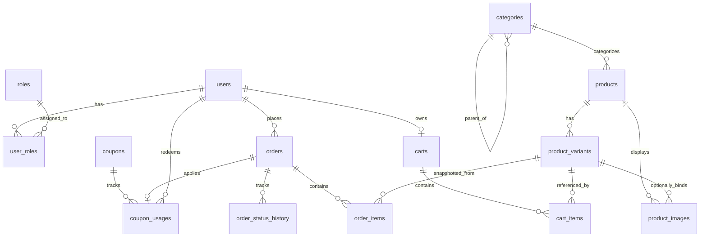
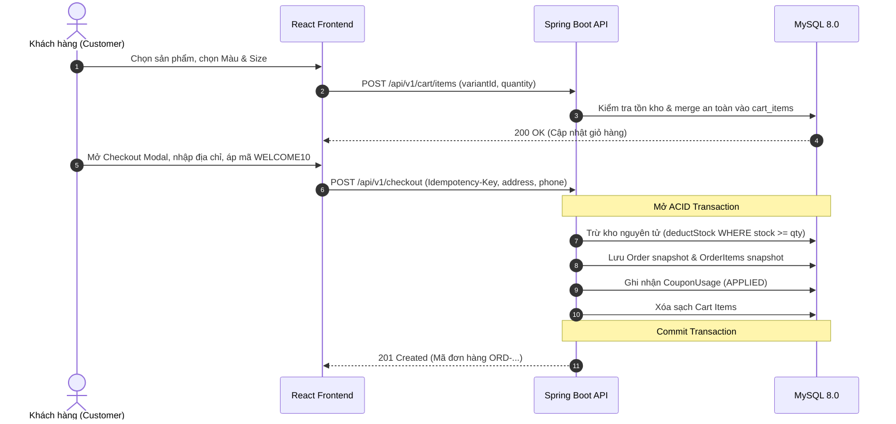
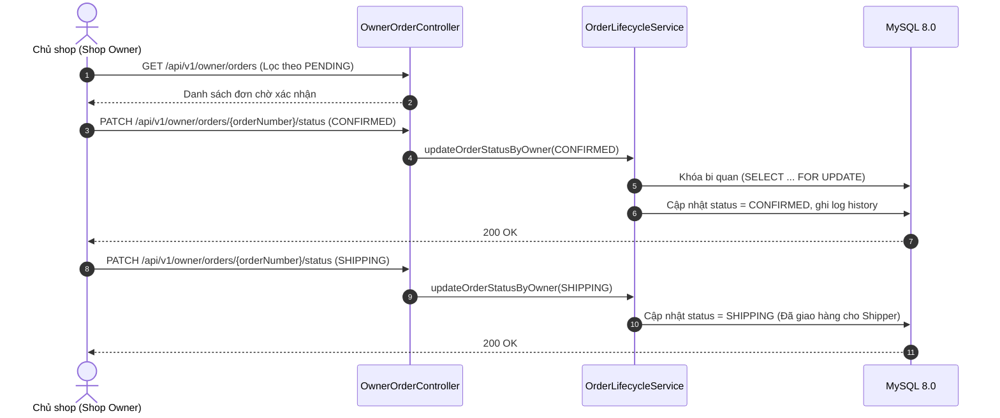
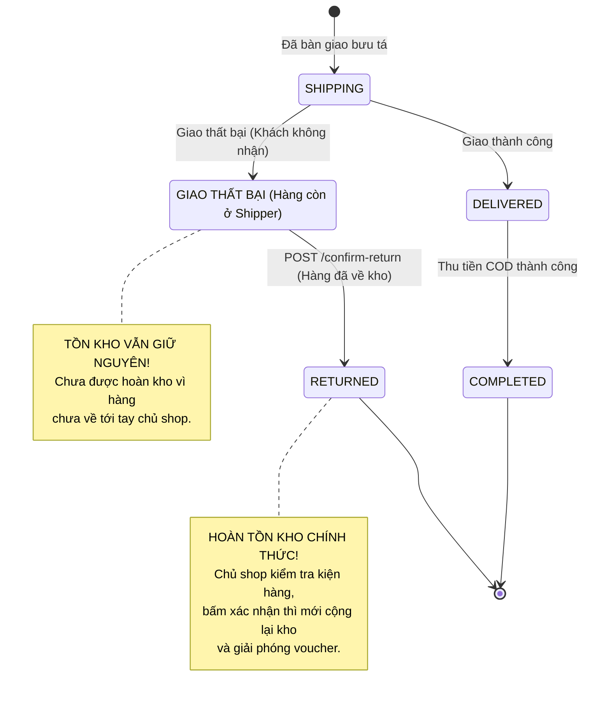
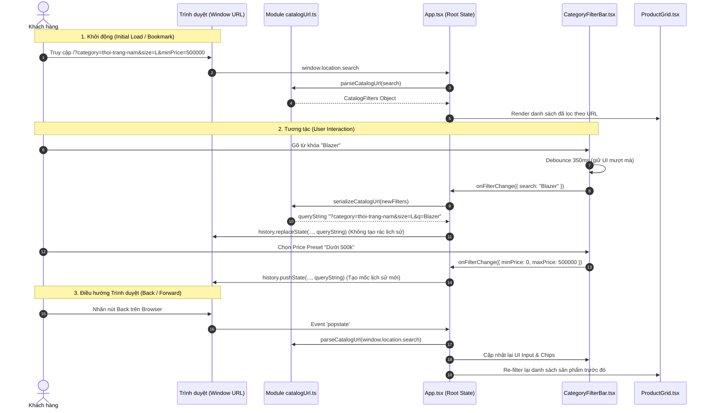

# CẨM NANG THIẾT KẾ HỆ THỐNG & KỸ THUẬT PHẦN MỀM THỰC CHIẾN
## HỆ THỐNG E-COMMERCE THỜI TRANG IVRE (SPRING BOOT 3 + REACT TYPESCRIPT + MYSQL)

---

## MỤC LỤC
1. [SƠ ĐỒ THỰC THỂ LIÊN KẾT (ERD) & TRIẾT LÝ THIẾT KẾ DỮ LIỆU](#1-sơ-đồ-thực-thể-liên-kết-erd--triết-lý-thiết-kế-dữ-liệu)
2. [WORKFLOWS ĐA TÁC NHÂN (MULTI-ACTOR WORKFLOWS)](#2-workflows-đa-tác-nhân-multi-actor-workflows)
   - 2.1. Luồng Khách hàng (Customer Journey)
   - 2.2. Luồng Chủ shop (Shop Owner Fulfillment)
   - 2.3. Luồng Đơn vị vận chuyển (Carrier / Shipper) & Bảo vệ tồn kho
   - 2.4. Luồng Quản trị viên (Admin Security & Audit)
3. [STATE MACHINE VÒNG ĐỜI ĐƠN HÀNG](#3-state-machine-vòng-đời-đơn-hàng)
4. [TƯ DUY KỸ THUẬT & XỬ LÝ LỖI ĐỒNG THỜI (CONCURRENCY POST-MORTEM)](#4-tư-duy-kỹ-thuật--xử-lý-lỗi-đồng-thời-concurrency-post-mortem)
   - 4.1. Race Condition khi hai Checkout cùng Idempotency Key
   - 4.2. Race Condition khi hai luồng cùng Hủy đơn hoặc cùng Xác nhận hàng hoàn
   - 4.3. Bẫy Hibernate: `LazyInitializationException` & `MultipleBagFetchException`
5. [TƯ DUY THIẾT KẾ LUỒNG NGHIỆP VỤ BỀN VỮNG (DEFENSE-IN-DEPTH)](#5-tư-duy-thiết-kế-luồng-nghiệp-vụ-bền-vững-defense-in-depth)

---

## 1. SƠ ĐỒ THỰC THỂ LIÊN KẾT (ERD) & TRIẾT LÝ THIẾT KẾ DỮ LIỆU

### 1.1. Sơ đồ quan hệ thực thể tổng thể (Mermaid ERD)



---

### 1.2. Triết lý Thiết kế & "Tại sao lại thiết kế như vậy?" (The "Why")

#### A. Tại sao TỪ CHỐI mô hình Entity-Attribute-Value (EAV / Dynamic Attributes)?
* **Bối cảnh cân nhắc**: Khi làm e-commerce, nhiều người nghĩ đến việc tạo các bảng động `attributes`, `attribute_values`, `product_attribute_values` để lưu size, màu, chất liệu, độ dài...
* **Lý do từ chối (ADR-010)**: 
  * Mô hình EAV biến câu lệnh truy vấn danh mục thành "cơn ác mộng" với 5–8 phép `LEFT JOIN` chỉ để lấy thông tin cơ bản của một sản phẩm.
  * Không thể đánh chỉ mục (Index) hiệu quả trên cột `value` dạng text của EAV.
  * Phân trang, lọc theo khoảng giá kết hợp size/màu và sắp xếp bị suy giảm hiệu năng nghiêm trọng.
* **Giải pháp lựa chọn (Pragmatic Relational + JSON)**:
  * Hai thuộc tính biến thể cốt lõi gắn liền với giao dịch là `size` và `color_name` / `color_hex` được đặt làm **cột quan hệ chuẩn** trong bảng `product_variants`. Điều này cho phép tạo chỉ mục tổng hợp `(product_id, size, color_name)` và `(size, price)` siêu nhanh.
  * Các thông số kỹ thuật mô tả (độ dài váy, độ co giãn, thông số size guide 3 vòng) được lưu dưới dạng cột `specifications JSON` trong `products`. Vừa linh hoạt, vừa giữ schema gọn gàng.

#### B. Tại sao `order_items` bắt buộc phải chụp SNAPSHOT thông tin thay vì chỉ trỏ Foreign Key sống?
* **Rủi ro nếu chỉ trỏ FK tới `product_variants`**:
  * Khi chủ shop đổi tên sản phẩm từ *"Áo Thun Basic"* thành *"Áo Thun Cao Cấp 2026"*, hóa đơn của khách mua từ năm 2024 cũng bị đổi tên theo.
  * Khi chủ shop tăng giá áo từ 300.000đ lên 450.000đ, hoặc xóa một size ngừng kinh doanh, hóa đơn cũ sẽ bị sai lệch doanh thu hoặc bị lỗi toàn vẹn dữ liệu (`ForeignKeyConstraintViolation`).
* **Giải pháp snapshot**: Bảng `order_items` lưu cố định:
  * `product_name_snapshot`: Tên sản phẩm tại giây phút bấm đặt hàng.
  * `sku_snapshot`: Mã SKU của biến thể.
  * `size_snapshot`, `color_snapshot`: Kích cỡ và màu sắc đã chốt.
  * `unit_price_snapshot`: Đơn giá chính xác khách đã mua.
  * `line_total`: Thành tiền dòng hàng.
  $\rightarrow$ Hóa đơn là chứng từ pháp lý và kế toán bất biến, không bao giờ bị biến động khi catalog thay đổi.

#### C. Tại sao giỏ hàng `cart_items` chỉ lưu Ý Định Mua Sắm (Purchase Intent), không lưu giá và không giữ kho?
* **Tại sao không giữ kho trong giỏ hàng?**:
  * Nếu khách thêm áo vào giỏ mà hệ thống trừ kho ngay (hoặc khóa kho), kẻ xấu có thể mở nhiều tab thêm hết hàng vào giỏ mà không thanh toán, làm cạn kiệt kho ảo (*Inventory Hoarding Attack*), khiến khách hàng thật không thể mua được.
* **Tại sao không lưu giá trong `cart_items`?**:
  * Nếu lưu giá lúc thêm vào giỏ, khách có thể để sản phẩm trong giỏ 1 tháng. Khi shop kết thúc đợt khuyến mãi, khách quay lại thanh toán với giá rẻ cũ $\rightarrow$ Shop chịu thiệt hại.
  * Do đó, giá và tình trạng còn hàng luôn được backend tính toán động từ `product_variants.price` và `stock_quantity` tại thời điểm đọc giỏ (`GET /api/v1/cart`).

#### D. Tại sao phải có ràng buộc duy nhất `uk_orders_user_idempotency (user_id, idempotency_key)`?
* **Rủi ro**: Khi mạng lag hoặc người dùng click đúp vào nút "XÁC NHẬN ĐẶT HÀNG", trình duyệt có thể gửi 2 request song song lên backend trong vòng 50ms. Nếu không có cơ chế chặn, backend sẽ tạo ra 2 đơn hàng trùng nhau và trừ kho 2 lần.
* **Giải pháp**: Frontend sinh ra một UUID `Idempotency-Key` khi mở popup thanh toán. Database đặt unique key kết hợp `(user_id, idempotency_key)`. Bất kỳ request thứ hai nào đến đồng thời sẽ bị MySQL chặn đứng bằng lỗi Duplicate Entry (SQL Error 1062). Backend bắt lỗi này, truy vấn lại đơn đã tạo hợp lệ trước đó và trả về kết quả an toàn (Replay).

#### E. Tại sao bảng `coupon_usages` cần cột `status` (`APPLIED` / `RELEASED`)?
* Khi khách áp dụng mã `WELCOME10` và đặt hàng, mã được đánh dấu `APPLIED`.
* Nếu đơn hàng bị hủy hợp lệ trước khi giao, ta không xóa bản ghi `coupon_usages` (để tránh mất vết kiểm toán audit), mà chuyển trạng thái sang `RELEASED` và ghi nhận `released_at`. Khách hàng sẽ được hoàn lại quyền sử dụng mã này cho đơn tiếp theo.

---

## 2. WORKFLOWS ĐA TÁC NHÂN (MULTI-ACTOR WORKFLOWS)

### 2.1. Luồng Khách hàng (Customer Journey)



---

### 2.2. Luồng Chủ shop (Shop Owner Fulfillment)



---

### 2.3. Luồng Đơn vị vận chuyển (Carrier / Shipper) & Quy tắc bảo vệ tồn kho

> [!IMPORTANT]
> **Quy tắc vàng về Tồn kho khi Giao hàng Thất bại**:
> Khi Shipper báo giao hàng không thành công (`SHIPPING` $\rightarrow$ `DELIVERY_FAILED` - ví dụ khách không nghe máy, sai địa chỉ), **TUYỆT ĐỐI KHÔNG ĐƯỢC HOÀN TỒN KHO NGAY LẬP TỨC**. 
> Lý do: Kiện hàng vẫn đang nằm trong cốp xe hoặc kho trung chuyển của đơn vị vận chuyển, chưa thực tế quay về kho của shop. Nếu hoàn kho ngay, hệ thống sẽ cho khách khác mua món đồ đó trong khi shop chưa có hàng thực tế để giao, dẫn đến nguy cơ bán khống (*Ghost Inventory*).



---

### 2.4. Luồng Quản trị viên (Admin Security & Audit)
* **RBAC Enforcement**: Toàn bộ endpoint dành cho chủ shop được bảo vệ bằng `@PreAuthorize("hasAnyRole('SHOP_OWNER', 'ADMIN')")`.
  * Khách vãng lai chưa đăng nhập: Trả về HTTP `401 Unauthorized`.
  * Khách hàng thông thường (`CUSTOMER`): Trả về HTTP `403 Forbidden`.
  * Chủ shop / Admin: Cho phép truy cập HTTP `200 OK`.
* **Audit Trail**: Mọi thay đổi trạng thái đơn đều ghi lại bản ghi trong bảng `order_status_history` gồm `from_status`, `to_status`, `changed_by`, `note`, `created_at`. Không ai có thể đổi trạng thái mà không để lại dấu vết.

---

## 3. STATE MACHINE VÒNG ĐỜI ĐƠN HÀNG

Bảng ma trận chuyển trạng thái hợp lệ trong [`OrderLifecycleService.java`](file:///d:/Lap%20trinh/FashionStore/backend/src/main/java/com/fashionstore/order/application/OrderLifecycleService.java):

| Trạng thái hiện tại | Trạng thái kế tiếp hợp lệ | Ai có quyền thực hiện? | Hiệu ứng tồn kho | Hiệu ứng Voucher |
| :--- | :--- | :--- | :--- | :--- |
| `PENDING` | `CONFIRMED` | Shop Owner / Admin | Không đổi | Giữ nguyên |
| `PENDING` | `CANCELLED` | Khách hàng / Shop Owner | **Hoàn tồn kho (+qty)** | Chuyển sang `RELEASED` |
| `CONFIRMED` | `SHIPPING` | Shop Owner / Admin | Không đổi | Giữ nguyên |
| `CONFIRMED` | `CANCELLED` | Khách hàng / Shop Owner | **Hoàn tồn kho (+qty)** | Chuyển sang `RELEASED` |
| `SHIPPING` | `DELIVERED` | Shop Owner / Admin | Không đổi | Giữ nguyên |
| `SHIPPING` | `DELIVERY_FAILED` | Shop Owner / Admin | **KHÔNG HOÀN KHO** | Giữ nguyên |
| `DELIVERY_FAILED` | `RETURNED` *(via confirm-return)* | Shop Owner / Admin | **Hoàn tồn kho (+qty)** | Chuyển sang `RELEASED` |
| `DELIVERED` | `COMPLETED` | Khách hàng / Shop Owner | Không đổi | COD đổi sang `PAID` |

*Các trạng thái kết thúc (Terminal States)*: `COMPLETED`, `CANCELLED`, `RETURNED` không thể chuyển đổi sang bất kỳ trạng thái nào khác.

---

## 4. TƯ DUY KỸ THUẬT & XỬ LÝ LỖI ĐỒNG THỜI (CONCURRENCY POST-MORTEM)

### 4.1. Race Condition khi hai Checkout cùng Idempotency Key
* **Tình huống**: Mạng chập chờn, client retry request checkout với cùng 1 `Idempotency-Key` cùng một lúc trên 2 luồng song song.
* **Tư duy xử lý kiến trúc**:
  * Tách làm 2 tầng: `CheckoutFacade` (Điều phối Idempotency) và `CheckoutService` (Xử lý Transactional).
  * Trong `CheckoutService`, câu lệnh `orderRepository.save(order)` được bảo vệ bởi Unique Constraint `uk_orders_user_idempotency` ở tầng database.
  * Khi luồng 2 cố gắng insert cùng key, MySQL văng lỗi `SQL Error: 1062 (Duplicate entry)`.
  * Exception này nổi lên `CheckoutFacade`. Facade bắt lỗi `DataIntegrityViolationException`, thực hiện mở transaction mới để đọc đơn hàng do luồng 1 vừa commit thành công, kiểm tra đối chiếu payload (số điện thoại, địa chỉ giao hàng) có khớp không. Nếu khớp $\rightarrow$ Trả về kết quả Replay thành công cho luồng 2 mà **không trừ kho 2 lần và không tạo 2 đơn**.

### 4.2. Race Condition khi hai luồng cùng Hủy đơn hoặc Xác nhận hàng hoàn
* **Tình huống**: Hai nhân viên kho cùng mở trang đơn hàng và cùng click nút "Xác nhận hàng hoàn về kho" tại cùng một giây.
* **Hậu quả nếu xử lý sai**: Cả hai luồng cùng đọc đơn thấy đang ở `DELIVERY_FAILED`, cả hai cùng cộng tồn kho $\rightarrow$ Tồn kho bị cộng gấp đôi so với thực tế!
* **Tư duy giải quyết**:
  * Sử dụng **Khóa ghi bi quan (Pessimistic Write Lock)**:
    ```java
    @Lock(LockModeType.PESSIMISTIC_WRITE)
    @Query("SELECT o FROM Order o WHERE o.orderNumber = :orderNumber")
    Optional<Order> findByOrderNumberWithLock(@Param("orderNumber") String orderNumber);
    ```
  * Khi luồng 1 gọi hàm này, MySQL phát lệnh `SELECT ... FOR UPDATE` trên dòng đơn hàng đó trong bảng `orders`.
  * Luồng 2 gọi hàm sẽ bị database chặn lại ở trạng thái chờ (Wait).
  * Luồng 1 kiểm tra đơn hợp lệ $\rightarrow$ Chuyển sang `RETURNED` $\rightarrow$ Cộng kho $\rightarrow$ Commit.
  * Khi luồng 1 commit xong, khóa được giải phóng. Luồng 2 mới được đọc dữ liệu. Lúc này luồng 2 thấy trạng thái đơn đã là `RETURNED` (Terminal state) $\rightarrow$ Lập tức ném ngoại lệ `INVALID_TRANSITION` (HTTP 400), dừng lại và không cộng kho lần 2.

### 4.3. Bẫy Hibernate: `LazyInitializationException` & `MultipleBagFetchException`

#### A. Lỗi `LazyInitializationException`:
* **Nguyên nhân**: Khi controller gọi `order.getItems()` hoặc `order.getStatusHistory()` ngoài phạm vi một `@Transactional` active và cấu hình `open-in-view: false`, Hibernate session đã đóng nên không thể tải dữ liệu quan hệ Lazy.
* **Cách khắc phục**:
  1. Thêm `@Transactional(readOnly = true)` trên các phương thức query của Controller.
  2. Sử dụng `@EntityGraph(attributePaths = {"items"})` trong `OrderRepository` để Hibernate tự động sinh câu lệnh `LEFT JOIN FETCH` nạp sẵn collection con chỉ trong 1 truy vấn.

#### B. Lỗi `MultipleBagFetchException`:
* **Nguyên nhân**: Trong JPA, nếu một Entity chứa 2 quan hệ `@OneToMany` dạng `List` (ví dụ cả `items` và `statusHistory` đều là `List`), Hibernate **nghiêm cấm** việc cùng lúc `JOIN FETCH` cả hai List trong một câu query SQL duy nhất (vì nó tạo ra tích Descartes - Cartesian Product khổng lồ, làm bùng nổ số dòng dữ liệu trả về và làm hỏng index của List).
* **Cách khắc phục chuẩn kiến trúc**:
  * Chỉ dùng `@EntityGraph` cho collection quan trọng nhất (`items`).
  * Với `statusHistory`, tách riêng ra repository truy vấn chuyên biệt: `orderStatusHistoryRepository.findByOrderIdOrderByCreatedAtAsc(orderId)`, kết hợp cấu hình `spring.jpa.properties.hibernate.default_batch_fetch_size: 25`.

---

## 5. TƯ DUY THIẾT KẾ LUỒNG NGHIỆP VỤ BỀN VỮNG (DEFENSE-IN-DEPTH)

1. **Tuyệt đối không tin Client (Zero Trust Frontend)**:
   * Frontend gửi lên: Tên sản phẩm, đơn giá, tổng tiền, quyền hạn role $\rightarrow$ Backend bỏ qua toàn bộ.
   * Backend tự nạp giá gốc từ Database, tự tính subtotal, tự tính coupon, tự tính phí ship, tự kiểm tra quyền từ `UserPrincipal` trong JWT HttpOnly Cookie.
2. **Tính nguyên tử trong thanh toán và xuất kho (Atomic Transactions)**:
   * Trừ kho $\rightarrow$ Tạo đơn $\rightarrow$ Chụp snapshot $\rightarrow$ Ghi coupon $\rightarrow$ Xóa giỏ hàng: Toàn bộ nằm trong **một Transaction duy nhất**. Bất kỳ lỗi nào phát sinh ở giữa (ví dụ voucher hết hạn hay không đủ kho) đều rollback 100% dữ liệu, không để lại dữ liệu rác.
3. **Mã lỗi nghiệp vụ có cấu trúc (Standardized API Error Envelope)**:
   * Mọi ngoại lệ trả về đều có mã lỗi máy đọc được (`IDEMPOTENCY_CONFLICT`, `ORDER_CANNOT_BE_CANCELLED`, `RETURN_CONFIRMATION_REQUIRED`, `INVALID_TRANSITION`) kèm thông điệp tiếng Việt thân thiện cho người dùng.

---

## 6. KIẾN TRÚC FRONTEND CATALOG VÀ ĐỒNG BỘ URL HAI CHIỀU (PHASE 5A)

### 6.1. Bài toán và Đánh giá Giải pháp (Architecture Trade-offs)
* **Bối cảnh**:
  Website thời trang **Ivre** sở hữu giao diện Runway / Lookbook sang trọng với Living Shader chuyển động nền (WebGL / Three.js). Khi người dùng tìm kiếm sản phẩm, lọc theo danh mục, chọn size/màu sắc, hoặc điều chỉnh khoảng giá, trạng thái lọc cần được phản ánh trực tiếp trên URL để người dùng có thể:
  1. Sao chép và chia sẻ liên kết sản phẩm (Shareable URL).
  2. Lưu bookmark trang tìm kiếm yêu thích.
  3. Nhấn nút Back / Forward trên trình duyệt mà không làm mất bộ lọc và không bị reload toàn trang.

* **So sánh hai trường phái kỹ thuật**:
  | Tiêu chí | Cài đặt Thư viện Router Ngoài (React Router / TanStack) | Chuẩn Web API Tối Giản (Native Web APIs - Được chọn) |
  | :--- | :--- | :--- |
  | **Kích thước Bundle** | Tăng thêm từ 15KB - 40KB gzipped cho router và state query. | **0 KB bổ sung**, tận dụng 100% Web APIs có sẵn trong trình duyệt. |
  | **Rủi ro với Living Shader** | Thường yêu cầu bọc toàn bộ App trong `<RouterProvider>`, có nguy cơ remount lại Canvas WebGL khiến hiệu ứng shader bị chớp nháy (flash) hoặc rò rỉ bộ nhớ GPU context. | **Giữ nguyên 100% Canvas Shader**, không can thiệp vào lifecycle của WebGL render loop. |
  | **Tương thích React 19** | Phải theo dõi breaking changes của các thư viện router bên ngoài với React 19 canary/stable. | Hoàn toàn độc lập với phiên bản React, tương thích tuyệt đối. |
  | **Kiểm soát URL** | Phụ thuộc vào lifecycle của thư viện bên thứ ba. | Kiểm soát chi tiết từng lời gọi `pushState` vs `replaceState`. |

### 6.2. Cơ chế Đồng bộ Hai Chiều (Bi-directional URL Synchronization)



1. **Khởi tạo trạng thái từ URL (Initial URL Deserialization)**:
   * Hàm `parseCatalogUrl(searchString)` tại [`frontend/src/utils/catalogUrl.ts`](file:///d:/Lap%20trinh/FashionStore/frontend/src/utils/catalogUrl.ts) bóc tách chuỗi truy vấn chuẩn hóa:
     - `category`: Chuỗi slug danh mục.
     - `size` & `color`: Chuỗi size/màu.
     - `minPrice` & `maxPrice`: Chuyển đổi an toàn từ chuỗi sang số nguyên (loại bỏ NaN).
     - `q`: Từ khóa tìm kiếm (tự động mapping sang `search` trong state backend).
     - `inStock`: Chuyển đổi boolean (`"true"` $\rightarrow$ `true`).
     - `sort`: Các kiểu sắp xếp hợp lệ (`price-asc`, `price-desc`, `newest`, `popular`).
     - `page`: Chuyển đổi từ số trang 1-based trên URL sang 0-based của Spring Data Pageable.

2. **Cập nhật URL theo hành vi người dùng (State-to-URL Serialization)**:
   * Khi người dùng thay đổi bộ lọc, hàm `serializeCatalogUrl(filters)` chỉ tuần tự hóa những thuộc tính khác mặc định, giữ cho URL luôn ngắn gọn và thẩm mỹ:
     - Các giá trị rỗng, `undefined`, số 0 đối với minPrice, hoặc `false` đối với inStock đều bị lược bỏ khỏi URL.
     - Phân loại rõ ràng giữa `history.replaceState` (dành cho tìm kiếm text theo thời gian thực để tránh người dùng phải ấn Back 20 lần cho 20 ký tự gõ) và `history.pushState` (dành cho click danh mục, phân trang, đổi preset).

3. **Lắng nghe sự kiện điều hướng ngược/xuôi (`popstate`)**:
   * Khi người dùng nhấn nút Back hoặc Forward trên thanh công cụ của trình duyệt, sự kiện `popstate` được kích hoạt.
   * `App.tsx` đăng ký listener `useEffect` để đồng bộ lại `filters` state từ `window.location.search`:
     ```typescript
     useEffect(() => {
       const handlePopState = () => {
         const parsed = parseCatalogUrl(window.location.search);
         setFilters(parsed);
       };
       window.addEventListener('popstate', handlePopState);
       return () => window.removeEventListener('popstate', handlePopState);
     }, []);
     ```

### 6.3. Tối ưu Hóa Hiệu Năng Ô Tìm Kiếm với Kỹ thuật Debounce (350ms)
* **Vấn đề**:
  Nếu mỗi khi người dùng gõ một ký tự trong ô tìm kiếm ta đều cập nhật ngay state toàn cục và lọc lại danh sách 50+ sản phẩm (kèm gọi API backend), giao diện sẽ bị lag giật (input delay), tạo cảm giác gián đoạn khó chịu.
* **Giải pháp Kỹ thuật**:
  - Tách biệt `searchTerm` thành một **Local Controlled State** bên trong [`CategoryFilterBar.tsx`](file:///d:/Lap%20trinh/FashionStore/frontend/src/components/CategoryFilterBar.tsx). Khi người dùng gõ, ô input phản hồi ngay tức thì (0ms latency).
  - Sử dụng một `useEffect` kèm bộ đếm thời gian `setTimeout(..., 350)`. Chỉ khi người dùng ngưng gõ phím đủ **350ms**, hàm callback `onFilterChange({ search: searchTerm.trim() || undefined })` mới được kích hoạt.
  - Sử dụng hàm cleanup `clearTimeout(timer)` để tự động hủy bỏ timeout trước đó nếu người dùng gõ tiếp ký tự mới trước khi hết 350ms.
  - Cung cấp nút xóa nhanh `✕` để người dùng có thể xóa ngay lập tức mà không cần chờ debounce.

### 6.4. Thanh Thẻ Lọc Đang Hoạt Động (Active Filter Chips)
* **Trải nghiệm Người dùng (UX Pattern)**:
  - Khi áp dụng nhiều bộ lọc cùng lúc (ví dụ: Danh mục "Thời trang nam", Size "L", Khoảng giá "500k - 1tr"), người dùng rất dễ quên mình đang áp dụng những điều kiện gì.
  - Hệ thống tự động trích xuất các điều kiện đang áp dụng thành các thanh thẻ (Chips) trực quan ngay dưới thanh công cụ:
    - `Danh mục: Thời trang nam ✕`
    - `Tìm kiếm: "Blazer" ✕`
    - `Giá: 500.000₫ - 1.000.000₫ ✕`
    - `Size: L ✕`
    - `Màu: Đen ✕`
    - `Chỉ hàng có sẵn ✕`
  - Nhấp vào nút `✕` của từng thẻ sẽ xóa riêng lẻ bộ lọc đó và cập nhật lại URL ngay lập tức.
  - Nút **"XÓA TẤT CẢ"** cho phép reset toàn bộ catalog về trạng thái ban đầu (`/`) với 1 click duy nhất.


