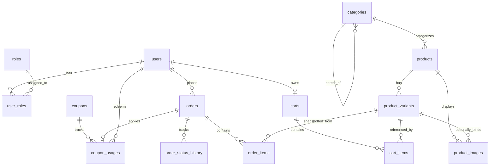
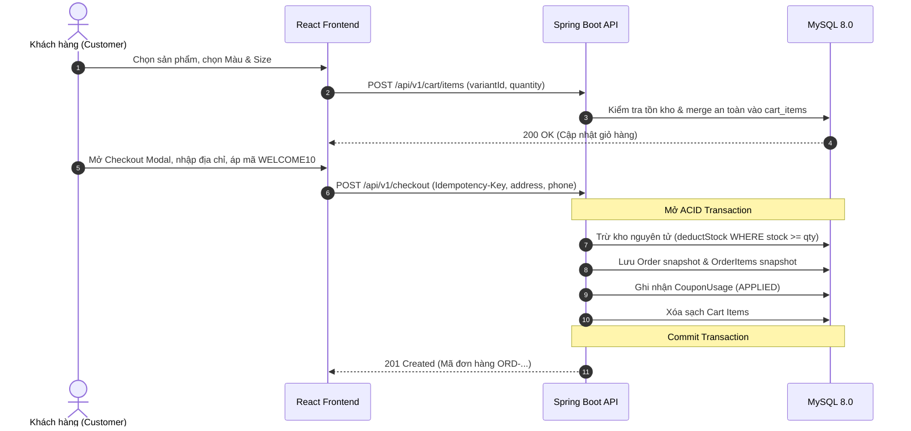
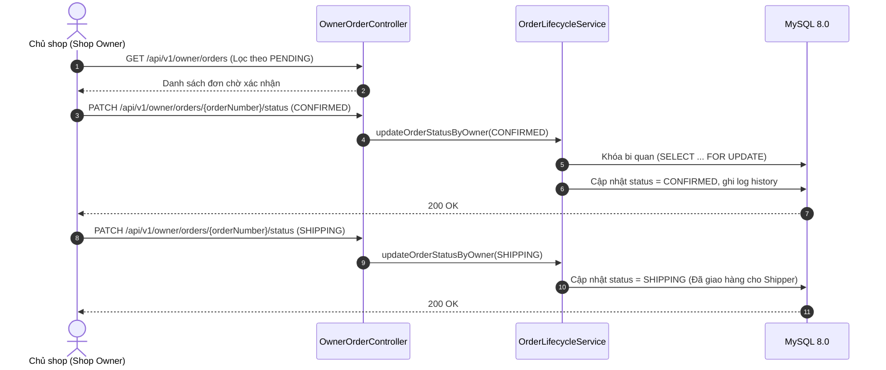
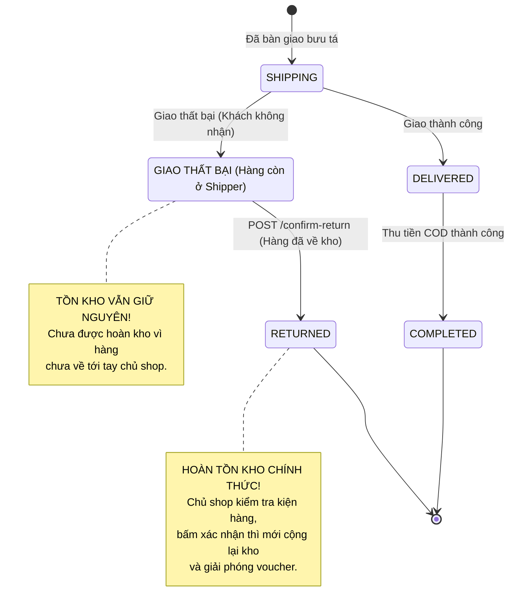
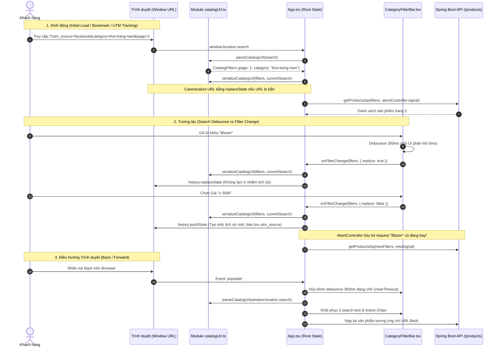
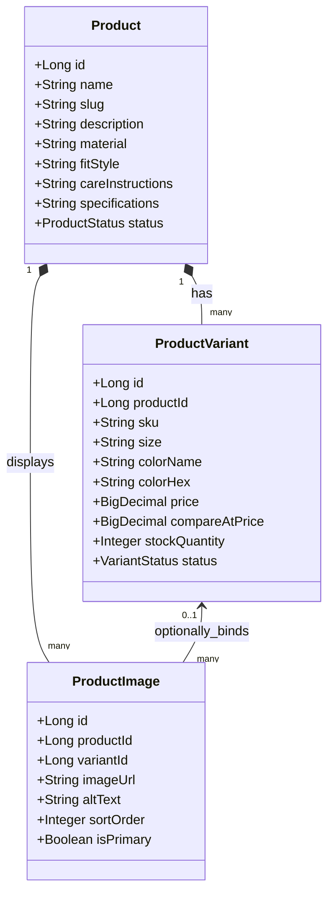

# CẨM NANG THIẾT KẾ HỆ THỐNG & KỸ THUẬT PHẦN MỀM THỰC CHIẾN
## HỆ THỐNG E-COMMERCE THỜI TRANG IVRE (SPRING BOOT 3 + REACT TYPESCRIPT + MYSQL)

---

## MỤC LỤC
1. [SƠ ĐỒ THỰC THỂ LIÊN KẾT (ERD) & TRIẾT LÝ THIẾT KẾ DỮ LIỆU](#1-sơ-đồ-thực-thể-liên-kết-erd--triết-lý-thiết-kế-dữ-liệu)
2. [WORKFLOWS ĐA TÁC NHÂN (MULTI-ACTOR WORKFLOWS)](#2-workflows-đa-tác-nhân-multi-actor-workflows)
   - 2.1. Luồng Khách hàng (Customer Journey)
   - 2.2. Luồng Chủ shop (Shop Owner Fulfillment)
   - 2.3. Luồng Đơn vị vận chuyển (Carrier / Shipper) & Bảo vệ tồn kho
   - 2.4. Luồng Quản trị viên (Admin Security & Audit)
3. [STATE MACHINE VÒNG ĐỜI ĐƠN HÀNG](#3-state-machine-vòng-đời-đơn-hàng)
4. [TƯ DUY KỸ THUẬT & XỬ LÝ LỖI ĐỒNG THỜI (CONCURRENCY POST-MORTEM)](#4-tư-duy-kỹ-thuật--xử-lý-lỗi-đồng-thời-concurrency-post-mortem)
   - 4.1. Race Condition khi hai Checkout cùng Idempotency Key
   - 4.2. Race Condition khi hai luồng cùng Hủy đơn hoặc cùng Xác nhận hàng hoàn
   - 4.3. Bẫy Hibernate: `LazyInitializationException` & `MultipleBagFetchException`
5. [TƯ DUY THIẾT KẾ LUỒNG NGHIỆP VỤ BỀN VỮNG (DEFENSE-IN-DEPTH)](#5-tư-duy-thiết-kế-luồng-nghiệp-vụ-bền-vững-defense-in-depth)
6. [KIẾN TRÚC CATALOG THỜI TRANG & ĐIỀU PHỐI URL (PHASE 5A)](#6-kiến-trúc-catalog-thời-trang--điều-phối-url-phase-5a)
   - 6.1. Đồng bộ 2 chiều URL & Web History API
   - 6.2. Phân tích Nguyên nhân Gốc rễ 3 Lỗi Điều phối (P1 & P2 Post-Mortem)
   - 6.3. Giải pháp Kiến trúc Điều phối Tập trung
   - 6.4. Active Filter Chips, Price Presets & Search Version Guard
7. [TRẢI NGHIỆM CHI TIẾT SẢN PHẨM LOOKBOOK & PHÂN TÍCH KỸ THUẬT PHÒNG THỦ (PHASE 5B)](#7-trải-nghiệm-chi-tiết-sản-phẩm-lookbook--phân-tích-kỹ-thuật-phòng-thủ-phase-5b)
   - 7.1. Sơ đồ Thực thể Biến thể Thời trang & Sequence Diagram
   - 7.2. Phòng chống Biến thể Ma (Ghost Variant Prevention Pattern)
   - 7.3. Thiết kế Bộ chọn Kích cỡ 4 Trạng thái (4-State Size Selector Matrix)
   - 7.4. Post-Mortem 1: Giá trị Biên của Khoảng giá (Inclusive Predicates)
   - 7.5. Post-Mortem 2: Bản chất Kỹ thuật của Search Version Guard
   - 7.6. Post-Mortem 3: Phòng chống Cuộc đua Microtask Mạng (`controller.signal.aborted`)
   - 7.7. Post-Mortem 4: Bản chất Remount Canvas WebGL (Cây Component vs Routing)

---

## 1. SƠ ĐỒ THỰC THỂ LIÊN KẾT (ERD) & TRIẾT LÝ THIẾT KẾ DỮ LIỆU

### 1.1. Sơ đồ quan hệ thực thể tổng thể (Mermaid ERD)



---

### 1.2. Triết lý Thiết kế & "Tại sao lại thiết kế như vậy?" (The "Why")

#### A. Tại sao TỪ CHỐI mô hình Entity-Attribute-Value (EAV / Dynamic Attributes)?
* **Bối cảnh cân nhắc**: Khi làm e-commerce, nhiều người nghĩ đến việc tạo các bảng động `attributes`, `attribute_values`, `product_attribute_values` để lưu size, màu, chất liệu, độ dài...
* **Lý do từ chối (ADR-010)**: 
  * Mô hình EAV biến câu lệnh truy vấn danh mục thành "cơn ác mộng" với 5–8 phép `LEFT JOIN` chỉ để lấy thông tin cơ bản của một sản phẩm.
  * Không thể đánh chỉ mục (Index) hiệu quả trên cột `value` dạng text của EAV.
  * Phân trang, lọc theo khoảng giá kết hợp size/màu và sắp xếp bị suy giảm hiệu năng nghiêm trọng.
* **Giải pháp lựa chọn (Pragmatic Relational + JSON)**:
  * Hai thuộc tính biến thể cốt lõi gắn liền với giao dịch là `size` và `color_name` / `color_hex` được đặt làm **cột quan hệ chuẩn** trong bảng `product_variants`. Điều này cho phép tạo chỉ mục tổng hợp `(product_id, size, color_name)` và `(size, price)` siêu nhanh.
  * Các thông số kỹ thuật mô tả (độ dài váy, độ co giãn, thông số size guide 3 vòng) được lưu dưới dạng cột `specifications JSON` trong `products`. Vừa linh hoạt, vừa giữ schema gọn gàng.

#### B. Tại sao `order_items` bắt buộc phải chụp SNAPSHOT thông tin thay vì chỉ trỏ Foreign Key sống?
* **Rủi ro nếu chỉ trỏ FK tới `product_variants`**:
  * Khi chủ shop đổi tên sản phẩm từ *"Áo Thun Basic"* thành *"Áo Thun Cao Cấp 2026"*, hóa đơn của khách mua từ năm 2024 cũng bị đổi tên theo.
  * Khi chủ shop tăng giá áo từ 300.000đ lên 450.000đ, hoặc xóa một size ngừng kinh doanh, hóa đơn cũ sẽ bị sai lệch doanh thu hoặc bị lỗi toàn vẹn dữ liệu (`ForeignKeyConstraintViolation`).
* **Giải pháp snapshot**: Bảng `order_items` lưu cố định:
  * `product_name_snapshot`: Tên sản phẩm tại giây phút bấm đặt hàng.
  * `sku_snapshot`: Mã SKU của biến thể.
  * `size_snapshot`, `color_snapshot`: Kích cỡ và màu sắc đã chốt.
  * `unit_price_snapshot`: Đơn giá chính xác khách đã mua.
  * `line_total`: Thành tiền dòng hàng.
  $\rightarrow$ Hóa đơn là chứng từ pháp lý và kế toán bất biến, không bao giờ bị biến động khi catalog thay đổi.

#### C. Tại sao giỏ hàng `cart_items` chỉ lưu Ý Định Mua Sắm (Purchase Intent), không lưu giá và không giữ kho?
* **Tại sao không giữ kho trong giỏ hàng?**:
  * Nếu khách thêm áo vào giỏ mà hệ thống trừ kho ngay (hoặc khóa kho), kẻ xấu có thể mở nhiều tab thêm hết hàng vào giỏ mà không thanh toán, làm cạn kiệt kho ảo (*Inventory Hoarding Attack*), khiến khách hàng thật không thể mua được.
* **Tại sao không lưu giá trong `cart_items`?**:
  * Nếu lưu giá lúc thêm vào giỏ, khách có thể để sản phẩm trong giỏ 1 tháng. Khi shop kết thúc đợt khuyến mãi, khách quay lại thanh toán với giá rẻ cũ $\rightarrow$ Shop chịu thiệt hại.
  * Do đó, giá và tình trạng còn hàng luôn được backend tính toán động từ `product_variants.price` và `stock_quantity` tại thời điểm đọc giỏ (`GET /api/v1/cart`).

#### D. Tại sao phải có ràng buộc duy nhất `uk_orders_user_idempotency (user_id, idempotency_key)`?
* **Rủi ro**: Khi mạng lag hoặc người dùng click đúp vào nút "XÁC NHẬN ĐẶT HÀNG", trình duyệt có thể gửi 2 request song song lên backend trong vòng 50ms. Nếu không có cơ chế chặn, backend sẽ tạo ra 2 đơn hàng trùng nhau và trừ kho 2 lần.
* **Giải pháp**: Frontend sinh ra một UUID `Idempotency-Key` khi mở popup thanh toán. Database đặt unique key kết hợp `(user_id, idempotency_key)`. Bất kỳ request thứ hai nào đến đồng thời sẽ bị MySQL chặn đứng bằng lỗi Duplicate Entry (SQL Error 1062). Backend bắt lỗi này, truy vấn lại đơn đã tạo hợp lệ trước đó và trả về kết quả an toàn (Replay).

#### E. Tại sao bảng `coupon_usages` cần cột `status` (`APPLIED` / `RELEASED`)?
* Khi khách áp dụng mã `WELCOME10` và đặt hàng, mã được đánh dấu `APPLIED`.
* Nếu đơn hàng bị hủy hợp lệ trước khi giao, ta không xóa bản ghi `coupon_usages` (để tránh mất vết kiểm toán audit), mà chuyển trạng thái sang `RELEASED` và ghi nhận `released_at`. Khách hàng sẽ được hoàn lại quyền sử dụng mã này cho đơn tiếp theo.

---

## 2. WORKFLOWS ĐA TÁC NHÂN (MULTI-ACTOR WORKFLOWS)

### 2.1. Luồng Khách hàng (Customer Journey)



---

### 2.2. Luồng Chủ shop (Shop Owner Fulfillment)



---

### 2.3. Luồng Đơn vị vận chuyển (Carrier / Shipper) & Quy tắc bảo vệ tồn kho

> [!IMPORTANT]
> **Quy tắc vàng về Tồn kho khi Giao hàng Thất bại**:
> Khi Shipper báo giao hàng không thành công (`SHIPPING` $\rightarrow$ `DELIVERY_FAILED` - ví dụ khách không nghe máy, sai địa chỉ), **TUYỆT ĐỐI KHÔNG ĐƯỢC HOÀN TỒN KHO NGAY LẬP TỨC**. 
> Lý do: Kiện hàng vẫn đang nằm trong cốp xe hoặc kho trung chuyển của đơn vị vận chuyển, chưa thực tế quay về kho của shop. Nếu hoàn kho ngay, hệ thống sẽ cho khách khác mua món đồ đó trong khi shop chưa có hàng thực tế để giao, dẫn đến nguy cơ bán khống (*Ghost Inventory*).



---

### 2.4. Luồng Quản trị viên (Admin Security & Audit)
* **RBAC Enforcement**: Toàn bộ endpoint dành cho chủ shop được bảo vệ bằng `@PreAuthorize("hasAnyRole('SHOP_OWNER', 'ADMIN')")`.
  * Khách vãng lai chưa đăng nhập: Trả về HTTP `401 Unauthorized`.
  * Khách hàng thông thường (`CUSTOMER`): Trả về HTTP `403 Forbidden`.
  * Chủ shop / Admin: Cho phép truy cập HTTP `200 OK`.
* **Audit Trail**: Mọi thay đổi trạng thái đơn đều ghi lại bản ghi trong bảng `order_status_history` gồm `from_status`, `to_status`, `changed_by`, `note`, `created_at`. Không ai có thể đổi trạng thái mà không để lại dấu vết.

---

## 3. STATE MACHINE VÒNG ĐỜI ĐƠN HÀNG

Bảng ma trận chuyển trạng thái hợp lệ trong [`OrderLifecycleService.java`](file:///d:/Lap%20trinh/FashionStore/backend/src/main/java/com/fashionstore/order/application/OrderLifecycleService.java):

| Trạng thái hiện tại | Trạng thái kế tiếp hợp lệ | Ai có quyền thực hiện? | Hiệu ứng tồn kho | Hiệu ứng Voucher |
| :--- | :--- | :--- | :--- | :--- |
| `PENDING` | `CONFIRMED` | Shop Owner / Admin | Không đổi | Giữ nguyên |
| `PENDING` | `CANCELLED` | Khách hàng / Shop Owner | **Hoàn tồn kho (+qty)** | Chuyển sang `RELEASED` |
| `CONFIRMED` | `SHIPPING` | Shop Owner / Admin | Không đổi | Giữ nguyên |
| `CONFIRMED` | `CANCELLED` | Khách hàng / Shop Owner | **Hoàn tồn kho (+qty)** | Chuyển sang `RELEASED` |
| `SHIPPING` | `DELIVERED` | Shop Owner / Admin | Không đổi | Giữ nguyên |
| `SHIPPING` | `DELIVERY_FAILED` | Shop Owner / Admin | **KHÔNG HOÀN KHO** | Giữ nguyên |
| `DELIVERY_FAILED` | `RETURNED` *(via confirm-return)* | Shop Owner / Admin | **Hoàn tồn kho (+qty)** | Chuyển sang `RELEASED` |
| `DELIVERED` | `COMPLETED` | Khách hàng / Shop Owner | Không đổi | COD đổi sang `PAID` |

*Các trạng thái kết thúc (Terminal States)*: `COMPLETED`, `CANCELLED`, `RETURNED` không thể chuyển đổi sang bất kỳ trạng thái nào khác.

---

## 4. TƯ DUY KỸ THUẬT & XỬ LÝ LỖI ĐỒNG THỜI (CONCURRENCY POST-MORTEM)

### 4.1. Race Condition khi hai Checkout cùng Idempotency Key
* **Tình huống**: Mạng chập chờn, client retry request checkout với cùng 1 `Idempotency-Key` cùng một lúc trên 2 luồng song song.
* **Tư duy xử lý kiến trúc**:
  * Tách làm 2 tầng: `CheckoutFacade` (Điều phối Idempotency) và `CheckoutService` (Xử lý Transactional).
  * Trong `CheckoutService`, câu lệnh `orderRepository.save(order)` được bảo vệ bởi Unique Constraint `uk_orders_user_idempotency` ở tầng database.
  * Khi luồng 2 cố gắng insert cùng key, MySQL văng lỗi `SQL Error: 1062 (Duplicate entry)`.
  * Exception này nổi lên `CheckoutFacade`. Facade bắt lỗi `DataIntegrityViolationException`, thực hiện mở transaction mới để đọc đơn hàng do luồng 1 vừa commit thành công, kiểm tra đối chiếu payload (số điện thoại, địa chỉ giao hàng) có khớp không. Nếu khớp $\rightarrow$ Trả về kết quả Replay thành công cho luồng 2 mà **không trừ kho 2 lần và không tạo 2 đơn**.

### 4.2. Race Condition khi hai luồng cùng Hủy đơn hoặc Xác nhận hàng hoàn
* **Tình huống**: Hai nhân viên kho cùng mở trang đơn hàng và cùng click nút "Xác nhận hàng hoàn về kho" tại cùng một giây.
* **Hậu quả nếu xử lý sai**: Cả hai luồng cùng đọc đơn thấy đang ở `DELIVERY_FAILED`, cả hai cùng cộng tồn kho $\rightarrow$ Tồn kho bị cộng gấp đôi so với thực tế!
* **Tư duy giải quyết**:
  * Sử dụng **Khóa ghi bi quan (Pessimistic Write Lock)**:
    ```java
    @Lock(LockModeType.PESSIMISTIC_WRITE)
    @Query("SELECT o FROM Order o WHERE o.orderNumber = :orderNumber")
    Optional<Order> findByOrderNumberWithLock(@Param("orderNumber") String orderNumber);
    ```
  * Khi luồng 1 gọi hàm này, MySQL phát lệnh `SELECT ... FOR UPDATE` trên dòng đơn hàng đó trong bảng `orders`.
  * Luồng 2 gọi hàm sẽ bị database chặn lại ở trạng thái chờ (Wait).
  * Luồng 1 kiểm tra đơn hợp lệ $\rightarrow$ Chuyển sang `RETURNED` $\rightarrow$ Cộng kho $\rightarrow$ Commit.
  * Khi luồng 1 commit xong, khóa được giải phóng. Luồng 2 mới được đọc dữ liệu. Lúc này luồng 2 thấy trạng thái đơn đã là `RETURNED` (Terminal state) $\rightarrow$ Lập tức ném ngoại lệ `INVALID_TRANSITION` (HTTP 400), dừng lại và không cộng kho lần 2.

### 4.3. Bẫy Hibernate: `LazyInitializationException` & `MultipleBagFetchException`

#### A. Lỗi `LazyInitializationException`:
* **Nguyên nhân**: Khi controller gọi `order.getItems()` hoặc `order.getStatusHistory()` ngoài phạm vi một `@Transactional` active và cấu hình `open-in-view: false`, Hibernate session đã đóng nên không thể tải dữ liệu quan hệ Lazy.
* **Cách khắc phục**:
  1. Thêm `@Transactional(readOnly = true)` trên các phương thức query của Controller.
  2. Sử dụng `@EntityGraph(attributePaths = {"items"})` trong `OrderRepository` để Hibernate tự động sinh câu lệnh `LEFT JOIN FETCH` nạp sẵn collection con chỉ trong 1 truy vấn.

#### B. Lỗi `MultipleBagFetchException`:
* **Nguyên nhân**: Trong JPA, nếu một Entity chứa 2 quan hệ `@OneToMany` dạng `List` (ví dụ cả `items` và `statusHistory` đều là `List`), Hibernate **nghiêm cấm** việc cùng lúc `JOIN FETCH` cả hai List trong một câu query SQL duy nhất (vì nó tạo ra tích Descartes - Cartesian Product khổng lồ, làm bùng nổ số dòng dữ liệu trả về và làm hỏng index của List).
* **Cách khắc phục chuẩn kiến trúc**:
  * Chỉ dùng `@EntityGraph` cho collection quan trọng nhất (`items`).
  * Với `statusHistory`, tách riêng ra repository truy vấn chuyên biệt: `orderStatusHistoryRepository.findByOrderIdOrderByCreatedAtAsc(orderId)`, kết hợp cấu hình `spring.jpa.properties.hibernate.default_batch_fetch_size: 25`.

---

## 5. TƯ DUY THIẾT KẾ LUỒNG NGHIỆP VỤ BỀN VỮNG (DEFENSE-IN-DEPTH)

1. **Tuyệt đối không tin Client (Zero Trust Frontend)**:
   * Frontend gửi lên: Tên sản phẩm, đơn giá, tổng tiền, quyền hạn role $\rightarrow$ Backend bỏ qua toàn bộ.
   * Backend tự nạp giá gốc từ Database, tự tính subtotal, tự tính coupon, tự tính phí ship, tự kiểm tra quyền từ `UserPrincipal` trong JWT HttpOnly Cookie.
2. **Tính nguyên tử trong thanh toán và xuất kho (Atomic Transactions)**:
   * Trừ kho $\rightarrow$ Tạo đơn $\rightarrow$ Chụp snapshot $\rightarrow$ Ghi coupon $\rightarrow$ Xóa giỏ hàng: Toàn bộ nằm trong **một Transaction duy nhất**. Bất kỳ lỗi nào phát sinh ở giữa (ví dụ voucher hết hạn hay không đủ kho) đều rollback 100% dữ liệu, không để lại dữ liệu rác.
3. **Mã lỗi nghiệp vụ có cấu trúc (Standardized API Error Envelope)**:
   * Mọi ngoại lệ trả về đều có mã lỗi máy đọc được (`IDEMPOTENCY_CONFLICT`, `ORDER_CANNOT_BE_CANCELLED`, `RETURN_CONFIRMATION_REQUIRED`, `INVALID_TRANSITION`) kèm thông điệp tiếng Việt thân thiện cho người dùng.

---

## 6. KIẾN TRÚC FRONTEND CATALOG VÀ ĐỒNG BỘ URL HAI CHIỀU (PHASE 5A)

### 6.1. Bài toán và Đánh giá Giải pháp (Architecture Trade-offs)
* **Bối cảnh**:
  Website thời trang **Ivre** sở hữu giao diện Runway / Lookbook sang trọng với Living Shader chuyển động nền (WebGL / Three.js). Khi người dùng tìm kiếm sản phẩm, lọc theo danh mục, chọn size/màu sắc, hoặc điều chỉnh khoảng giá, trạng thái lọc cần được phản ánh trực tiếp trên URL để người dùng có thể:
  1. Sao chép và chia sẻ liên kết sản phẩm (Shareable URL).
  2. Lưu bookmark trang tìm kiếm yêu thích.
  3. Nhấn nút Back / Forward trên trình duyệt mà không làm mất bộ lọc và không bị reload toàn trang.

* **So sánh hai trường phái kỹ thuật**:
  | Tiêu chí | Cài đặt Thư viện Router Ngoài (React Router / TanStack) | Chuẩn Web API Tối Giản (Native Web APIs - Được chọn) |
  | :--- | :--- | :--- |
  | **Kích thước Bundle** | Tăng thêm từ 15KB - 40KB gzipped cho router và state query. | **0 KB bổ sung**, tận dụng 100% Web APIs có sẵn trong trình duyệt. |
  | **Rủi ro với Living Shader** | Thường yêu cầu bọc toàn bộ App trong `<RouterProvider>`, có nguy cơ remount lại Canvas WebGL khiến hiệu ứng shader bị chớp nháy (flash) hoặc rò rỉ bộ nhớ GPU context. | **Giữ nguyên 100% Canvas Shader**, không can thiệp vào lifecycle của WebGL render loop. |
  | **Tương thích React 19** | Phải theo dõi breaking changes của các thư viện router bên ngoài với React 19 canary/stable. | Hoàn toàn độc lập với phiên bản React, tương thích tuyệt đối. |
  | **Kiểm soát URL** | Phụ thuộc vào lifecycle của thư viện bên thứ ba. | Kiểm soát chi tiết từng lời gọi `pushState` vs `replaceState`. |

### 6.2. Cơ chế Đồng bộ Hai Chiều (Bi-directional URL Synchronization) & Chống Race Condition



#### Quy tắc Điều phối Lịch sử Trình duyệt (`pushState` vs `replaceState`):
1. **Dùng `pushState`**:
   - Khi chuyển trang phân trang (`page 1 -> 2`, giải quyết trọn vẹn User Story 2 để người dùng ấn Back quay lại trang 1).
   - Khi đổi danh mục, chọn size, màu, kiểu sắp xếp (sort), chọn khoảng giá, xóa từng chip hoặc bấm "XÓA TẤT CẢ".
   - *Quy tắc chống rác*: Nếu chuỗi query tuần tự hóa mới trùng hoàn toàn với query hiện tại trên trình duyệt (`currentQuery === newQuery`), tuyệt đối không gọi `pushState` để tránh tạo duplicate history entries.
2. **Dùng `replaceState`**:
   - Khi cập nhật từ khóa tìm kiếm sau khi hết 350ms debounce (để người dùng không phải ấn Back 15 lần cho 15 ký tự vừa gõ).
   - Khi chuẩn hóa URL ban đầu (canonicalization) lúc component vừa mount nếu phát hiện URL trên bookmark bị sai lệch (ví dụ `minPrice > maxPrice` hoặc `page=0`).

#### Kỹ thuật Chống Stale Response / Race Condition bằng `AbortController`:
* **Vấn đề**: Khi mạng chập chờn hoặc người dùng click liên tiếp giữa các danh mục, request cũ bay đi có thể trả về sau request mới, dẫn đến kết quả cũ ghi đè lên giao diện mới.
* **Giải pháp Kỹ thuật**:
  - `getProductsApi` trong [`catalogApi.ts`](file:///d:/Lap%20trinh/FashionStore/frontend/src/api/catalogApi.ts) nhận thêm tham số tùy chọn `signal?: AbortSignal`.
  - Trong `App.tsx`, mỗi khi `filters` thay đổi, một `AbortController` mới được khởi tạo và truyền `signal` vào API.
  - Hàm cleanup của `useEffect` tự động gọi `controller.abort()`, lập tức hủy kết nối mạng của request cũ.
  - Khối `.catch()` nhận diện lỗi `AbortError` (`err.name === 'AbortError'`) và bỏ qua hoàn toàn: không hiển thị thông báo lỗi mạng cho người dùng, và không tắt cờ `isCatalogLoading` của request mới đang xử lý.

#### Quy tắc Kiểm tra & Làm sạch URL (Strict URL Validation & Sanitization):
* **Trang (`page`)**: Bắt buộc là số nguyên dương $\ge 1$ và $\le 10000$ (`Number.isInteger(p) && p >= 1`). Nếu là số âm, số thập phân (`page=1.5`), `NaN`, hoặc `Infinity` $\rightarrow$ tự động fallback về trang 1 (`page: 0` trong backend state).
* **Khoảng giá (`minPrice`, `maxPrice`)**: Phải là số hữu hạn không âm $\ge 0$ (`Number.isFinite && p >= 0`). Nếu trên URL xuất hiện `minPrice > maxPrice`, parser tự động **loại bỏ cả hai cận**. Trên giao diện drawer, nếu người dùng nhập sai sẽ hiển thị thông báo lỗi màu đỏ và không áp dụng bộ lọc sai.
* **Bảo toàn tham số ngoại lai**: Khi serialize URL, hệ thống chỉ sửa đổi các key thuộc catalog (`category`, `size`, `color`, `minPrice`, `maxPrice`, `q`, `inStock`, `sort`, `page`). Giữ nguyên 100% `pathname`, `hash`, và các tham số tiếp thị như `utm_source`, `utm_campaign`, `ref`, `fbclid`.
* **Cận giá bao gồm (Inclusive Price Boundaries)**: Backend SQL sử dụng `>=` và `<=`. Do đó, nhãn hiển thị và chip thể hiện chuẩn toán học: `≤ 500k`, `500k - 1 triệu`, `1 - 2 triệu`, `≥ 2 triệu`.
* **Bảo tồn Màu sắc**: Giữ nguyên tên màu UTF-8 tiếng Việt (ví dụ: "Đen Than", "Be Cát") hoặc mã màu Hex (`#FFFFFF`), không tự ý ép sang alias không dấu.
* **Kiểm thử tự động Đơn vị**: Toàn bộ 11 test cases trong [`catalogUrl.test.ts`](file:///d:/Lap%20trinh/FashionStore/frontend/src/utils/catalogUrl.test.ts) được thực thi tự động qua Node 24 native test runner (`node --test`), đạt tỷ lệ vượt qua 100% với thời gian chạy dưới 150ms mà không cần cài đặt thêm bất kỳ thư viện bên thứ ba nào.

### 6.3. Tối ưu Hóa Hiệu Năng Ô Tìm Kiếm Debounce & Bài học Xử lý Race Condition (Post-Mortem)
* **Bối cảnh & Vấn đề**:
  Khi tích hợp debounce tìm kiếm (350ms) vào một Single Page App có URL synchronization và nhiều bộ lọc tương tác (Category, Size, Color, Price Chip), nếu chỉ dùng closure thông thường của JavaScript trong `setTimeout`, hệ thống sẽ xuất hiện 3 lỗi đồng thời (race condition / state desync) cực kỳ hiểm hóc:
  1. **Lỗi P1 — Back bị ghi đè**: Người dùng đang ở Danh mục A, gõ từ khóa tìm kiếm (timer 350ms đang chờ). Người dùng bấm nút **Back** của trình duyệt về Danh mục B. Vì từ khóa trước và sau khi Back đều giống nhau (`undefined`), dependency `[filters.search]` không đổi nên timer cũ không bị hủy. Khi 350ms trôi qua, callback timer nổ với state cũ và đưa người dùng quay ngược trở lại Danh mục A.
  2. **Lỗi P2 — Chip giá tự hồi sinh (Price Resurrect)**: Người dùng đang lọc theo khoảng giá, sau đó gõ tìm kiếm. Trong lúc timer đang chờ, người dùng bấm nút `✕` xóa chip khoảng giá. Timer debounce cũ đã bắt giữ (capture) đối tượng `filters` chứa khoảng giá cũ từ closure. Khi timer nổ, nó ghi đè lại giá cũ, khiến chip giá vừa xóa tự động xuất hiện trở lại.
  3. **Lỗi P2 — Ô tìm kiếm lệch pha kết quả (Input Out-of-Sync)**: Người dùng gõ từ khóa rồi lập tức nhấp chuyển danh mục. Timer bị hủy trước khi kịp áp dụng từ khóa, nhưng ô input vẫn giữ nguyên chữ vừa gõ dù catalog chỉ hiển thị danh mục mà không có từ khóa đó.

* **Giải pháp Kỹ thuật Phòng thủ Đa tầng (Defense-in-Depth Architecture)**:
  - **1. Centralized Synchronous Dispatcher (`applyFilter`) & Anti-Stale Ref**:
    Thay vì chỉ cập nhật `filtersRef.current` bất đồng bộ trong `useEffect` (chạy sau paint), mọi tương tác của người dùng (`handleCategorySelect`, `handleSizeSelect`, `handleColorSelect`, `handlePricePresetSelect`, `handleClearPrice`, `handleSortChange`, `handleInStockToggle`, Enter key, debounce timer callback) đều đi qua hàm điều phối tập trung:
    ```typescript
    const applyFilter = (next: ProductFilterParams, options?: { replace?: boolean }) => {
      if (searchTimerRef.current) {
        clearTimeout(searchTimerRef.current);
        searchTimerRef.current = null;
      }
      filtersRef.current = next; // Đồng bộ tức thì, không có độ trễ paint
      onFilterChange(next, options);
    };
    ```
  - **2. Semantic Change Detection (Bảo vệ Typing Draft trước Re-render tham chiếu)**:
    Khi component cha re-render và truyền vào prop `filters` mới nhưng có cùng nội dung ngữ nghĩa (`newFilters = { ...filters }`), nếu chỉ so sánh tham chiếu `filters !== prevFilters` sẽ làm mất ký tự người dùng đang gõ dở. Hệ thống phân tách thành 2 kiểm tra:
    ```typescript
    const isCommittedSearchChanged = filters.search !== prevFilters.search;
    const isContextFilterChanged =
      filters.categorySlug !== prevFilters.categorySlug ||
      filters.size !== prevFilters.size ||
      filters.color !== prevFilters.color ||
      filters.minPrice !== prevFilters.minPrice ||
      filters.maxPrice !== prevFilters.maxPrice ||
      filters.sort !== prevFilters.sort ||
      filters.page !== prevFilters.page ||
      filters.inStockOnly !== prevFilters.inStockOnly;

    if (filters !== prevFilters) {
      setPrevFilters(filters);
      // Chỉ reset input khi search thực sự đã commit đổi, hoặc ngữ cảnh bộ lọc bị đổi
      if (isCommittedSearchChanged || isContextFilterChanged) {
        setSearchInput(filters.search || '');
      }
      setCustomMinPrice(filters.minPrice !== undefined ? filters.minPrice.toString() : '');
      setCustomMaxPrice(filters.maxPrice !== undefined ? filters.maxPrice.toString() : '');
      setPriceInputError(null);
    }
    ```
  - **3. Hủy timer toàn diện theo `[filters]`**:
    `useEffect` hủy timer lắng nghe toàn bộ đối tượng `[filters]` thay vì chỉ `[filters.search]`. Bất kể thay đổi nào (Back/Forward `popstate`, đổi danh mục, đổi trang, xóa chip giá), timer đang chờ đều bị `clearTimeout` lập tức.
  - **4. Bàn giao phím Enter**: Bổ sung `onKeyDown` cho ô input, cho phép người dùng nhấn `Enter` để flush tìm kiếm ngay lập tức mà không cần chờ hết 350ms.
  - **5. Kiểm thử Tự động Transpile Component thật trên Node VM**:
    Bộ kiểm thử [`frontend/src/utils/filterDebounceCoordination.test.ts`](file:///d:/Lap%20trinh/FashionStore/frontend/src/utils/filterDebounceCoordination.test.ts) đọc trực tiếp file TSX thật, transpile qua TypeScript Compiler API và chạy trong Node `vm` với 8 kịch bản bao phủ trọn vẹn vòng đời và edge cases (P1 Back, P2 Price, P2 Category, Enter flush, Rapid typing, Unmount cleanup, Referential re-render draft preservation, Context filter change draft reset).
  - **6. Kiểm chứng Thực tế trên Trình duyệt Live (Chrome DevTools MCP)**:
    Đã thực thi chuỗi hành động trên Chrome thật tại `http://localhost:5173`: click chọn danh mục, xóa chip giá, nhập tìm kiếm "Blazer", xác minh debounce 350ms tự động nổ trên URL thật, và gọi `window.history.back()` để kiểm chứng input tự xóa rỗng và chip giá phục hồi. Không có lỗi console.

### 6.4. Thanh Thẻ Lọc Đang Hoạt Động (Active Filter Chips), Price Presets & Cơ chế Bảo vệ Thế hệ (Search Version Guard)

#### A. Trải nghiệm Người dùng & Tương tác Thẻ Lọc (UX Pattern):
- Khi áp dụng nhiều bộ lọc cùng lúc (ví dụ: Danh mục "Thời trang nam", Size "L", Khoảng giá "500k - 1tr", Sắp xếp "Giá: Tăng dần"), hệ thống trích xuất các điều kiện đang áp dụng thành các thanh thẻ (Chips) trực quan ngay dưới thanh công cụ:
  - `Danh mục: Thời trang nam ✕`
  - `Tìm kiếm: "Blazer" ✕`
  - `Giá: 500.000₫ - 1.000.000₫ ✕`
  - `Size: L ✕`
  - `Màu: Đen ✕`
  - `Chỉ hàng có sẵn ✕`
  - `Xếp: Giá: Tăng dần ✕` (Bổ sung trong Phase 5A.2: cho phép người dùng nhìn thấy và click xóa riêng lẻ để trở về sắp xếp mặc định `newest`).
- Nhấp vào nút `✕` của từng thẻ sẽ xóa riêng lẻ bộ lọc đó và cập nhật lại URL ngay lập tức thông qua `pushState`.
- Nút **"XÓA TẤT CẢ"**: Reset toàn bộ bộ lọc catalog về trạng thái ban đầu (`/`), xóa ô input tìm kiếm, hủy timer debounce đang chờ và dọn sạch các thẻ lọc, đồng thời giữ nguyên 100% các query parameters ngoại lai (như `utm_source`, `ref`).

#### B. Khoảng Giá Định Sẵn (Price Presets) & Nhập Giá Tùy Chỉnh:
- **4 Presets Chuẩn**:
  1. `Dưới 500k` (`maxPrice: 500000`, nhãn `≤ 500k`)
  2. `500k – 1 triệu` (`minPrice: 500000, maxPrice: 1000000`)
  3. `1 – 2 triệu` (`minPrice: 1000000, maxPrice: 2000000`)
  4. `Trên 2 triệu` (`minPrice: 2000000`, nhãn `≥ 2 triệu`)
- **Khả năng Toggle-off**: Nhấp lại vào preset đang active sẽ hủy bộ lọc giá đó ngay lập tức mà không cần mở drawer để xóa.
- **Input Tùy chỉnh & Phím Enter**: Hỗ trợ nhập `minPrice` và `maxPrice` độc lập (chỉ min, chỉ max, hoặc cả hai). Bổ sung sự kiện `onKeyDown` (Enter) giúp người dùng áp dụng giá tức thì.
- **Bảo tồn giá trị 0**: Sửa chữa triệt để lỗi ép kiểu lỏng lẻo (`min > 0`) bằng cách sử dụng `min !== undefined ? min : undefined`, cho phép lọc sản phẩm có giá từ 0₫ trở lên.

#### C. Cơ chế Bảo vệ Thế hệ (Search Version Guard Pattern):
- **Vấn đề lý thuyết & thực tế**: Trong một số báo cáo trước, có giả định rằng "useEffect luôn chạy trước callback setTimeout đang chờ trong Event Loop". Tuy nhiên, theo đặc tả chính thức của React, `useEffect` chạy bất đồng bộ sau khi paint, và thứ tự thực thi thực tế phụ thuộc vào microtask, macrotask của browser engine và scheduler. Việc chỉ dựa vào `useEffect` cleanup có thể tiềm ẩn rủi ro race condition nếu một tác vụ bất đồng bộ khác chen ngang.
- **Giải pháp Phòng thủ Bất khả xâm phạm (Generation Guard)**:
  - Khởi tạo `searchVersionRef = useRef(0)`.
  - Trong hàm `handleSearchChange`, mỗi khi lên lịch một debounce timer mới, ta ghi nhận thế hệ hiện tại:
    ```typescript
    searchVersionRef.current += 1;
    const currentVersion = searchVersionRef.current;
    searchTimerRef.current = setTimeout(() => {
      // Version Guard: Nếu thế hệ đã bị tăng do bất kỳ thao tác nào khác, hủy callback ngay lập tức
      if (searchVersionRef.current !== currentVersion) {
        return;
      }
      applyFilter({ ...filtersRef.current, search: trimmed || undefined, page: 0 }, { replace: true });
    }, 350);
    ```
  - Trong `applyFilter` và trong `useEffect([filters])`, ta chủ động tăng `searchVersionRef.current += 1`.
  - Bằng cách này, bất kể browser hay React lập lịch callback thế nào, bất kỳ timer nào được lên lịch trước một hành động thay đổi bộ lọc đều bị vô hiệu hóa 100% một cách nguyên tử mà không cần phụ thuộc vào sự may rủi của Event Loop.

#### D. Bằng chứng Kiểm thử & Nghiệm thu:
- **Kiểm thử tự động**: 23/23 tests tự động PASS (11 tests cho `catalogUrl.test.ts` và 12 tests cho `filterDebounceCoordination.test.ts`), bao phủ toàn diện 12 kịch bản điều phối component, debounce, preset toggle-off, sort chip và version guard.
- **Kiểm thử Live Browser (Chrome DevTools MCP)**: Xác minh trực tiếp trên Chrome thật tại `http://localhost:5173`: thao tác bấm "XÓA TẤT CẢ", chọn preset `500k - 1 triệu`, toggle-off preset, chọn Sort "GIÁ: TĂNG DẦN" và click nút `✕` trên thẻ sort chip để khôi phục `newest`. Toàn bộ hành vi URL và UI hoàn toàn chính xác.

---

## 7. TRẢI NGHIỆM CHI TIẾT SẢN PHẨM LOOKBOOK & PHÂN TÍCH KỸ THUẬT PHÒNG THỦ (PHASE 5B)

### 7.1. Sơ đồ Thực thể Biến thể Thời trang & Sequence Diagram

#### A. Sơ đồ Quan hệ Biến thể & Hình ảnh (Fashion Variant Domain Model):


#### B. Sơ đồ Điều phối Chi tiết Sản phẩm & Dynamic Gallery (Lookbook Sequence Diagram):
```mermaid
sequenceDiagram
    autonumber
    actor User as Khách hàng (User)
    participant Grid as ProductCard (Catalog)
    participant App as App.tsx (URL & Modal Coordinator)
    participant Modal as ProductDetailModal.tsx
    participant Drawer as SizeGuideDrawer.tsx
    participant Cart as CartContext & MiniCart
    participant Backend as Spring Boot API

    User->>Grid: Click vào thẻ sản phẩm (slug: "dam-lua-maxi")
    Grid->>App: onSelect(product)
    App->>App: pushState("?product=dam-lua-maxi")
    App->>Modal: Hiển thị Modal & khóa cuộn (overflow: hidden)
    Modal->>Backend: GET /api/v1/products/dam-lua-maxi
    Backend-->>Modal: Trả về Full Detail (Variants, Images, Specs)

    Note over Modal: 1. Khởi tạo & Dynamic Gallery
    Modal->>Modal: Chọn Color Swatch đầu tiên (Trắng) & Size khả dụng đầu tiên (S)
    Modal->>Modal: Lọc ảnh: [variantId == whiteVariant.id] + [!variantId]

    Note over User,Modal: 2. Đổi Màu & Ghost Variant Prevention
    User->>Modal: Click Swatch màu "Xanh Rêu" (Chỉ có Size M, L; không có S)
    Modal->>Modal: Phát hiện Size S không tồn tại ở Xanh Rêu
    Modal->>Modal: Auto-resolve: Tự động chuyển selectedSize sang "M"
    Modal->>Modal: Cập nhật Gallery sang ảnh Xanh Rêu & cập nhật giá biến thể

    Note over User,Drawer: 3. Tra cứu Bảng số đo (Size Guide)
    User->>Modal: Click "Bảng quy đổi size ↗"
    Modal->>Drawer: Mở SizeGuideDrawer (truyền specs JSON + category fallback)
    User->>Drawer: Nhấn phím Escape
    Drawer->>Drawer: stopPropagation & đóng drawer (Modal vẫn mở nguyên vẹn)

    Note over User,Cart: 4. Thêm vào giỏ hàng
    User->>Modal: Click "THÊM VÀO GIỎ HÀNG"
    alt Khách vãng lai (Chưa đăng nhập)
        Modal->>App: openAuthModal('login')
    else Khách đã đăng nhập
        Modal->>Backend: POST /api/v1/cart/items (variantId, qty: 1)
        Backend-->>Modal: 200 OK (Thành công)
        Modal->>App: onClose() (popState URL về catalog)
        Modal->>Cart: openCart() (Trượt mở Mini-Cart Drawer)
    end
```

---

### 7.2. Phòng chống Biến thể Ma (Ghost Variant Prevention Pattern)

#### A. Vấn đề thực tế (Problem Statement):
Trong ngành thời trang, số lượng size giữa các màu sắc hiếm khi đồng đều 100%. Ví dụ một mẫu áo sơ mi:
- Màu **Trắng**: Đầy đủ size `S`, `M`, `L`.
- Màu **Xanh Rêu**: Chỉ sản xuất size `M`, `L` (hoàn toàn không có size `S`).
- Màu **Đen**: Đã bán hết size `S` và `M`, chỉ còn duy nhất size `L`.

Nếu component React chỉ lưu trữ 2 state độc lập:
```typescript
const [selectedColor, setSelectedColor] = useState('Trắng');
const [selectedSize, setSelectedSize] = useState('S');
```
Khi người dùng đang chọn `(Trắng, S)` rồi nhấp vào swatch `Xanh Rêu`, nếu không có logic can thiệp, state sẽ trở thành `(Xanh Rêu, S)`.
Hệ quả:
1. `variants.find(v => v.colorName === 'Xanh Rêu' && v.size === 'S')` sẽ trả về `undefined`.
2. Giao diện bị crash hoặc hiển thị giá tiền rỗng, trạng thái tồn kho rỗng.
3. Khi người dùng nhấn nút "THÊM VÀO GIỎ HÀNG", frontend gửi `variantId = undefined` hoặc giá trị rác, khiến backend trả về lỗi HTTP 400 Bad Request. Đây chính là lỗi **Biến thể Ma (Ghost Variant)**.

#### B. Giải pháp Tự động Giải quyết Biến thể (Auto-Resolution Algorithm):
Khi người dùng nhấp chọn màu mới `newColor`, hệ thống kích hoạt thuật toán tự động giải quyết size:
```typescript
const handleColorChange = (newColor: string) => {
  setSelectedColor(newColor);

  // 1. Trích xuất tất cả biến thể thuộc màu mới
  const variantsOfColor = variants.filter(v => v.colorName === newColor);
  
  // 2. Kiểm tra xem size hiện tại có tồn tại ở màu mới hay không
  const currentSizeStillExists = variantsOfColor.some(v => v.size === selectedSize);

  if (!currentSizeStillExists) {
    // 3. Auto-resolve: Tìm size đầu tiên còn hàng
    const firstInStock = variantsOfColor.find(v => v.stockQuantity > 0);
    if (firstInStock) {
      setSelectedSize(firstInStock.size);
    } else if (variantsOfColor.length > 0) {
      // 4. Fallback: Nếu tất cả size màu mới đều hết hàng, chọn size đầu tiên được sản xuất
      setSelectedSize(variantsOfColor[0].size);
    }
  }
};
```
Nhờ thuật toán này, cặp `(selectedColor, selectedSize)` luôn luôn chỉ đến một bản ghi `ProductVariant` có thật trong database.

---

### 7.3. Thiết kế Bộ chọn Kích cỡ 4 Trạng thái (4-State Size Selector Matrix)

Để mang lại trải nghiệm thời trang cao cấp, nút bấm chọn Size không thể chỉ có 2 trạng thái bật/tắt đơn giản. Hệ thống phân định ma trận 4 trạng thái như sau:

| Trạng thái | Điều kiện Logic | Giao diện Trực quan | Tương tác Click |
| :--- | :--- | :--- | :--- |
| **1. Active / Selected** | `size === selectedSize` | Nền đen `#000000`, viền vàng champagne `#C7AD83`, chữ trắng đậm, shadow nhẹ | Đang chọn |
| **2. In-Stock** | `variant.stockQuantity > 0` | Nền trong suốt, viền `#262626`, chữ xám `#D4D4D4`, hover viền `#C7AD83` | Kích hoạt `setSelectedSize(size)` |
| **3. Out-of-Stock** | Có variant nhưng `stockQuantity === 0` | Nền `#0D0D0D`, viền `#1F1F1F`, chữ gạch ngang mờ `#525252`, icon/tooltip "Hết hàng" | `disabled` (Không cho click) |
| **4. Not Offered** | Hoàn toàn không có variant cho màu này | Độ mờ sâu `opacity-25`, viền mờ `#171717`, chữ `#404040` | `disabled` (Không cho click) |

---

### 7.4. Post-Mortem 1: Giá trị Biên của Khoảng giá (Price Boundary Post-Mortem)

#### A. Hiện tượng:
Hai bộ lọc preset giá định sẵn:
- Preset 1: `≤ 500k` (`maxPrice = 500.000₫`)
- Preset 2: `500k – 1 triệu` (`minPrice = 500.000₫, maxPrice = 1.000.000₫`)

Một sản phẩm có giá chính xác `500.000₫` (ví dụ: Áo sơ mi Oxford hoặc Áo thun Polo) sẽ xuất hiện trong kết quả của bộ lọc nào?

#### B. Phân tích Predicates Backend:
Trong file `ProductSpecification.java`:
```java
if (filter.getMinPrice() != null) {
    predicates.add(cb.greaterThanOrEqualTo(root.get("minPrice"), filter.getMinPrice()));
}
if (filter.getMaxPrice() != null) {
    predicates.add(cb.lessThanOrEqualTo(root.get("maxPrice"), filter.getMaxPrice()));
}
```
Cả hai toán tử trong JPA Criteria API đều là toán tử **bao hàm (inclusive)**:
- Với Preset 1 (`maxPrice: 500000`): SQL sinh ra là `WHERE price <= 500000`. Giá 500.000₫ thỏa mãn điều kiện `<=`.
- Với Preset 2 (`minPrice: 500000, maxPrice: 1000000`): SQL sinh ra là `WHERE price >= 500000 AND price <= 1000000`. Giá 500.000₫ thỏa mãn điều kiện `>=`.

#### C. Kết luận & Quyết định Nghiệp vụ:
- **Hành vi thực tế**: Sản phẩm có giá đúng 500.000₫ xuất hiện ở **cả hai bộ lọc**.
- **Ý nghĩa người dùng (E-commerce UX Convention)**: Khách hàng tìm sản phẩm "Dưới hoặc bằng 500k" kỳ vọng thấy sản phẩm 500k; đồng thời khách tìm "Từ 500k đến 1 triệu" cũng kỳ vọng thấy sản phẩm 500k bắt đầu từ ngưỡng này. Do đó, việc dùng nhãn trực quan `≤ 500k` và `500k – 1 triệu` với toán tử bao hàm hai đầu là hoàn toàn chuẩn xác về mặt UX và toán học.
- Bộ test suite [`frontend/src/utils/productDetailCoordination.test.ts`](file:///d:/Lap%20trinh/FashionStore/frontend/src/utils/productDetailCoordination.test.ts) đã kiểm chứng tường minh trường hợp biên này (Scenario 9).

---

### 7.5. Post-Mortem 2: Bản chất Kỹ thuật của Search Version Guard

#### A. Đính chính Khái niệm Kỹ thuật:
- Trong một số tài liệu sơ bộ, cơ chế bảo vệ thế hệ `searchVersionRef` đôi khi được gọi theo thuật ngữ hình tượng là *"Atomic Abort"*.
- **Làm rõ bản chất**: JavaScript trên trình duyệt là môi trường đơn luồng dựa trên Event Loop. `searchVersionRef` **không phải là cơ chế hủy luồng hệ điều hành (OS thread abort/kill)** và không can thiệp vào bộ lập lịch cấp thấp của trình duyệt.
- **Bản chất thực sự**: Đây là một **Logical Generation Counter (Bộ đếm thế hệ logic)**.
  - Khi một timer debounce được khởi tạo, nó "chụp lại" số hiệu thế hệ tại thời điểm lên lịch (`currentVersion = searchVersionRef.current`).
  - Khi người dùng thực hiện bất kỳ hành vi thay đổi bộ lọc nào khác (click danh mục, xóa chip, đổi sort, xóa tất cả), ta chủ động tăng `searchVersionRef.current += 1`.
  - Khi timer đánh thức callback sau 350ms, bước đầu tiên callback thực hiện là so sánh:
    `if (searchVersionRef.current !== currentVersion) return;`
  - Nếu số hiệu thế hệ đã thay đổi, callback tự giác rút lui trong im lặng mà không phát sinh bất kỳ side-effect nào lên state hoặc URL.
- Đây là mô hình phòng thủ logic hoàn toàn độc lập với việc `useEffect` dọn dẹp chạy trước hay sau `setTimeout` callback.

---

### 7.6. Post-Mortem 3: Phòng chống Cuộc đua Microtask Mạng (`controller.signal.aborted`)

#### A. Cuộc đua Vi tác vụ (Microtask Race Condition):
Khi component thực hiện hủy request mạng:
```typescript
const controller = new AbortController();
// ...
controller.abort();
```
Trong trình duyệt, khi `fetch()` hoàn tất tải dữ liệu ngay tại thời điểm `abort()` được gọi (hoặc nằm trong microtask queue chuẩn bị giải quyết Promise), một race condition có thể xảy ra:
1. `fetch()` giải quyết thành công và đưa callback `.then(response => response.json())` vào microtask queue.
2. Ngay trước khi microtask được thực thi, người dùng bấm nút Back hoặc đổi danh mục, kích hoạt `controller.abort()`.
3. Microtask callback `.then()` chạy và tiến hành `setProducts(data)` với dữ liệu cũ!

#### B. Giải pháp Phòng thủ Đa tầng (Defense-in-Depth):
Trong file [`frontend/src/App.tsx`](file:///d:/Lap%20trinh/FashionStore/frontend/src/App.tsx), ta bổ sung chốt kiểm tra tín hiệu hủy ngay bên trong nhánh resolve của Promise:
```typescript
getProductsApi(currentFilters, controller.signal)
  .then((data) => {
    // Chặn microtask race condition: Nếu request đã bị abort, hủy ngay lập tức
    if (controller.signal.aborted) {
      return;
    }
    setProducts(data.items);
    setTotalPages(data.totalPages);
    setTotalElements(data.totalElements);
    setIsLoading(false);
  })
  .catch((err) => {
    if (err.name === 'AbortError') return;
    // ...
  });
```
Điều này đảm bảo dù Promise có kịp resolve trước khi error handler kích hoạt, dữ liệu cũ cũng không thể ghi đè lên UI.

---

### 7.7. Post-Mortem 4: Bản chất Remount Canvas WebGL (Cây Component vs Routing)

#### A. Phân tích Kỹ thuật:
- Câu hỏi đặt ra: *Có phải bản thân các thư viện router (như React Router) là nguyên nhân gây unmount Canvas WebGL?*
- **Câu trả lời**: Không. Về mặt kiến trúc React, việc một component có bị unmount hay không hoàn toàn phụ thuộc vào **vị trí của nó trong cây component (Component Tree Hierarchy)** và việc `key` của nó có bị thay đổi giữa các lần render hay không.
- Nếu một ứng dụng dùng React Router đặt `<LivingRunwayCanvas />` ở root layout component nằm phía trên `<Outlet />`, thì khi chuyển từ `/` sang `/products/:slug`, canvas sẽ **không bị remount**.
- **Tuy nhiên, lý do giữ nguyên Modal Lookbook qua URL Param (`?product=<slug>`)**:
  1. *Độ phức tạp kiến trúc*: Việc đưa React Router vào đòi hỏi tái cấu trúc toàn bộ cây layout, đóng gói lại routing context và thêm dependency ngoài (~40KB).
  2. *Trải nghiệm Lookbook*: Trong thời trang cao cấp, khi khách bấm xem chi tiết váy/áo, họ muốn xem tức thì dưới dạng overlay lookbook, giữ nguyên 100% vị trí cuộn trang của danh mục phía sau.
  3. *Hiệu năng*: Việc kết hợp Modal với URL parameter vừa đạt được deep-linking hoàn hảo, vừa giữ WebGL Canvas thở liên tục trong suốt phiên mua sắm mà không tốn một dòng cấu hình route phức tạp.


